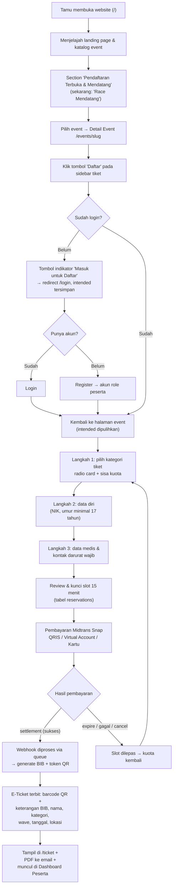
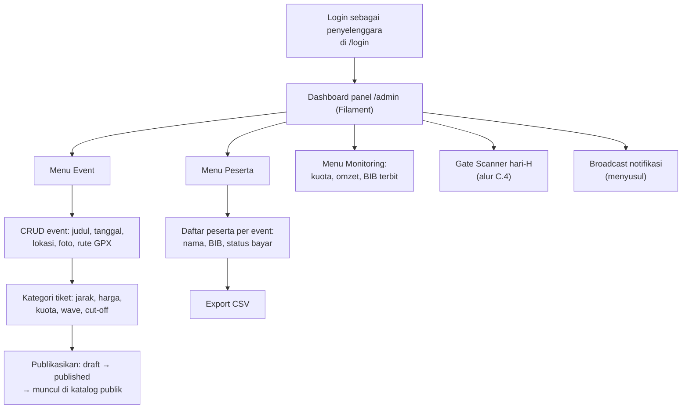
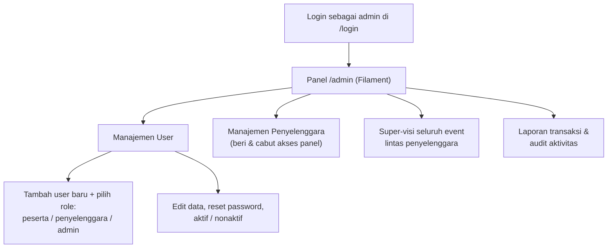
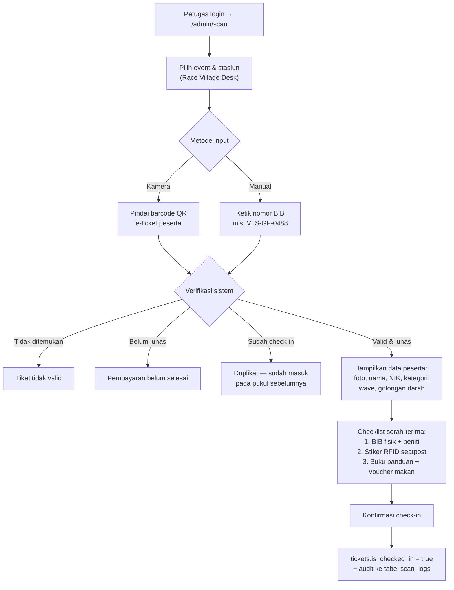
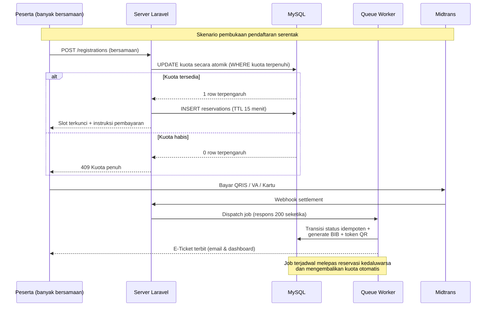
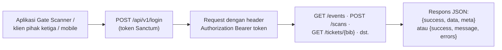

# PRD — Rancangan Alur & Kriteria Penilaian Portofolio — Velosha

> **Dokumen:** Rancangan alur pengguna (peserta, penyelenggara, admin, gate scanner), identifikasi masalah, spesifikasi REST API, strategi high concurrency, dan matriks 12 kriteria penilaian portofolio.
> **Versi:** 1.0
> **File:** `Velosha/PRD/PRD-Alur-dan-Penilaian.md`
> **Terkait:** [PRD-Velosha.md](PRD-Velosha.md) (master) · [PRD-Fitur-Database.md](PRD-Fitur-Database.md) (spek fitur & tabel) · [PRD-Desain-UI-UX.md](PRD-Desain-UI-UX.md) (design system)
> **Status:** Dokumen spesifikasi. Kolom Status pada Bagian A mencerminkan implementasi nyata saat ini.

---

## A. Kriteria Penilaian Portofolio (12 Item)

Aplikasi ini dibuat sebagai portofolio dan dinilai pada 12 kriteria berikut. Tabel ini menjadi peta: setiap kriteria ditautkan ke bagian dokumen yang menjawabnya.

**Legenda status:** **Selesai** = sudah ada & berfungsi · **Sebagian** = tampilan/struktur ada, logika/back-end belum · **Belum** = belum ada (spesifikasi di dokumen ini siap diimplementasikan)

| # | Kriteria | Yang Dinilai | Dijawab Oleh | Status |
|---|---|---|---|---|
| 1 | **Identifikasi Masalah** | 5 masalah nyata + analisis dampak + solusi yang ditawarkan | Bagian B; PRD-Velosha §1.2 | **Selesai** |
| 2 | **Arsitektur** | Struktur sistem berlapis: Laravel 12 (MVC), middleware `role`, Livewire 4 (frontend interaktif), Filament 5 (panel admin), ERD database, alur request & routing | PRD-Velosha §4, §6, §7; PRD-Fitur-Database §3 | **Sebagian** — arsitektur jelas; tabel `reservations`, `scan_logs`, `personal_access_tokens` belum ada di DB |
| 3 | **REST API** | Kelengkapan endpoint, autentikasi token, format respons/error, rate limit, dokumentasi | **Bagian D** (belum ada `routes/api.php`) | **Belum** |
| 4 | **Auth** | Laravel Breeze email/password, 3 role (`peserta`/`penyelenggara`/`admin`), guard URL intended, sosial login (mode demo), otorisasi per role | PRD-Velosha §4.1 hal.4; alur C.1 | **Selesai** |
| 5 | **Landing Page** | Hero editorial, filter kategori, grid race, metrik, footer, copy Bahasa Indonesia yang ringkas | PRD-Velosha §4.1 hal.1 | **Selesai** |
| 6 | **Detail Event** | Galeri foto, info race, peta & GPX, profil elevasi, sticky booking sidebar | PRD-Velosha §4.1 hal.3 | **Selesai** |
| 7 | **Pemilihan Tiket** | Kategori jarak (GF/MF/FR/KOM), harga, sisa kuota, radio card pemilihan tiket | C.1 langkah 1; PRD-Velosha §4.1 hal.5 | **Sebagian** — UI ada, logika kuota belum |
| 8 | **Checkout** | Form 3 langkah (kategori → data diri & medis → pembayaran), validasi, ringkasan biaya | PRD-Velosha §4.1 hal.5; C.1 | **Sebagian** — view statis, belum terikat data |
| 9 | **Responsive Desain** | Mobile/tablet/desktop, nav mobile, breakpoint Tailwind, WCAG AA | PRD-Desain-UI-UX; PRD-Velosha §3 | **Sebagian** — sudah responsif, review visual mobile (Fase 2) belum final |
| 10 | **Payment Concept** | Konsep Midtrans Snap (QRIS/VA/Kartu), alur webhook `settlement`, kegagalan & pengembalian kuota | PRD-Velosha §5; PRD-Fitur-Database §2.5 & §4.1; C.5 | **Sebagian** — simulasi pop-up, integrasi asli belum |
| 11 | **High Concurrency** | Atomic pengurangan kuota, kunci slot 15 menit, antrean (queue), rate limit, idempotensi webhook, anti-overbooking | **Bagian E**; C.5; PRD-Fitur-Database §4.1 | **Belum** |
| 12 | **Gate Scanner** | Pindai QR/BIB, verifikasi status tiket, checklist serah-terima, anti pindai ganda, log audit | **C.4**; PRD-Fitur-Database §4.2 | **Belum** — halaman `/admin/scan` belum ada; rencana jadi halaman Filament |

---

## B. Identifikasi Masalah (5 Masalah)

Lima masalah berikut adalah landasan identifikasi masalah portofolio — masing-masing ditautkan ke solusi dan kriteria yang dinilai.

### B.1 — Server down saat pendaftaran dibuka serentak
> *"Server down karena kebanyakan yang ikut, saat pendaftaran dibuka saat waktu bersamaan."*

- **Dampak:** Calon peserta kehilangan slot, transaksi macet, kepercayaan pada penyelenggara turun. Ini masalah paling umum pada sistem tiket balap.
- **Solusi Velosha:** strategi **High Concurrency** di Bagian E — pengurangan kuota atomik di database (`UPDATE ... WHERE kuota terpenuhi`), kunci slot 15 menit lewat tabel `reservations`, webhook yang diproses di antrean (queue), dan rate limiting.
- **Kriteria terkait:** High Concurrency, Arsitektur.

### B.2 — UI/UX yang kurang nyaman dipandang
> *"UI/UX yang kurang nyaman di pandang."*

- **Dampak:** Pengguna ragu melanjutkan pendaftaran, informasi race sulit dipindai, tingkat penyelesaian checkout turun.
- **Solusi Velosha:** design system ketat — border radius 1px luar / 3px dalam tanpa kapsul, 4 warna inti (Amber Race, Warm Gray, Dark Teal, Light Teal dekoratif), kontras WCAG AA, tipografi Inter, teks editorial yang ringkas, dan hierarki visual berbasis foto.
- **Kriteria terkait:** Landing Page, Detail Event, Checkout, Responsive Desain.

### B.3 — Pendaftaran tersebar di DM/WA media sosial
> *"Terkadang ada yang menggelar event di FB, IG, jadi daftar nya bisa lewat DM dan WA itu yang menyebabkan kesulitan."*

- **Dampak:** Data peserta tercecer dan tidak terstruktur, konfirmasi manual berjam-jam, risiko salah transfer dan *double booking*, tidak ada tiket/QR otomatis.
- **Solusi Velosha:** satu alur end-to-end di website: katalog event → pilih tiket → form tervalidasi → pembayaran resmi → e-ticket QR otomatis. Tidak ada pendaftaran manual lewat pesan.
- **Kriteria terkait:** Auth, Checkout, Payment Concept.

### B.4 — Wajib mengunduh aplikasi pihak ketiga
> *"Harus download aplikasi yang sudah disediakan, tidak bisa menggunakan website — [mainsepeda.com](https://www.mainsepeda.com/)."*

- **Dampak:** Pengguna baru enggan menginstal aplikasi hanya untuk mendaftar satu event; pembaruan aplikasi memutus alur pendaftaran.
- **Solusi Velosha:** Velosha **100% berbasis web** — responsif di browser ponsel, tablet, dan desktop, tanpa instalasi. Seluruh alur (daftar → bayar → e-ticket → scan) terjadi di website.
- **Kriteria terkait:** Responsive Desain, Landing Page.

### B.5 — Gagal proses verifikasi akun
> *"Gagal proses verifikasi akun — [contoh kasus nyata](https://www.mainsepeda.com/r/5041/gagal-verifikasi-mainsepeda-app-no-worries-ini-solusinya)."*

- **Dampak:** Calon peserta tidak bisa masuk ke akunnya padahal sudah mendaftar, batal mendaftar event, dan kehilangan slot.
- **Solusi Velosha:** autentikasi standar Laravel Breeze yang transparan — login email/password, lupa password dengan reset link jelas, pesan error yang dapat ditindaklanjuti, serta social login (mode demo) sebagai jalur alternatif tanpa proses verifikasi aplikasi yang rumit.
- **Kriteria terkait:** Auth.

---

## C. Rancangan Alur

### C.1 — Alur Utama Peserta: Tamu → Barcode E-Ticket

Narasi langkah (alur inti):

1. **Pengguna membuka website** (`/`) dan menjelajah landing page — melihat hero, metrik, dan daftar race.
2. **Menuju section pendaftaran** — saat ini berlabel **"Race Mendatang"**, ke depan diubah menjadi **"Pendaftaran Terbuka & Mendatang"** (lihat Bagian F).
3. **Memilih event** → membuka Detail Event (`/events/{slug}`) — membaca rute, peta, elevasi, lalu melihat sidebar pemilihan tiket.
4. **Menekan tombol "Daftar"** — tombol ini menampilkan **indikator keadaan**, dan bagi pengunjung **belum login** bertanda *"Masuk untuk Daftar"*.
5. **Dipaksa login dulu** — diarahkan ke `/login` dengan **URL intended tersimpan**; pengunjung bisa login atau mendaftar akun baru (role `peserta`).
6. **Kembali ke halaman event** — setelah login, sistem mengembalikan ke URL semula (intended dipulihkan; bila role tidak berwenang, dijatuhkan ke halaman rumah role — sudah diimplementasikan).
7. **Mengisi form pendaftaran** — Langkah 1 memilih kategori tiket (jarak, harga, sisa kuota) → Langkah 2 data diri (NIK, umur minimum 17 tahun) → Langkah 3 data medis & kontak darurat (wajib).
8. **Membayar** — ringkasan biaya → pop-up Midtrans Snap (QRIS / Virtual Account / Kartu) dengan batas waktu 15 menit (slot dikunci, lihat Bagian E).
9. **Mendapat barcode beserta keterangan** — setelah pembayaran terverifikasi, e-ticket terbit: **QR code unik + keterangan** (nomor BIB, nama, kategori jarak, wave start, tanggal & lokasi race), tampil di `/ticket`, dikirim sebagai PDF ke email, dan muncul di Dashboard Peserta.



**Keadaan tombol "Daftar" (state per tampilan):**

| Kondisi pengunjung | Tampilan tombol | Perilaku |
|---|---|---|
| Tamu (belum login) | **"Masuk untuk Daftar"** + indikator belum login | → `/login`, URL intended disimpan |
| Sudah login, belum terdaftar di event ini | **"Daftar Sekarang"** (CTA aktif) | → form pendaftaran 3 langkah |
| Sudah terdaftar di event ini | **"Sudah Terdaftar"** (nonaktif) | → menuju E-Ticket / Dashboard |
| Kuota kategori habis | **"Kuota Penuh"** (nonaktif) | tawarkan kategori lain |
| Pendaftaran ditutup / event selesai | **"Pendaftaran Ditutup"** (nonaktif) | tampilkan info jadwal berikutnya |

**Kasus tepi (edge cases):**
- Tamu membuka `/admin` → redirect ke `/login` dengan intended tersimpan *(sudah diimplementasi)*.
- Peserta login dengan intended `/admin` → dijatuhkan ke `/dashboard` *(sudah diimplementasi, guard `User::canVisit`)*.
- Slot kedaluwarsa 15 menit tanpa bayar → kuota otomatis dikembalikan oleh job terjadwal.
- Pembayaran dobel/di-klik dua kali → webhook diproses **idempoten** per `order_id`.
- User yang sama mendaftar event/kategori yang sama dua kali → ditolak unique constraint `(user_id, event_category_id)`.
- QR dipindai dua kali di gate → peringatan duplikat + log *(C.4)*.

---

### C.2 — Alur Penyelenggara (Race Director)

> Menjawab kebingungan *"penyelenggara login, masuk dashboard, bisa tambah event, lihat daftar yang sudah terdaftar, dan lain-lain"*.

1. **Login** di `/login` dengan akun role `penyelenggara` → masuk **dashboard panel `/admin`** (Filament).
2. **Kelola Event** — buat/edit event: judul, deskripsi, tanggal, lokasi + koordinat, foto galeri, video YouTube, file rute GPX.
3. **Kelola Kategori Tiket per event** — kode (GF/MF/FR/KOM), jarak, elevasi, harga, **kuota**, wave start, cut-off time → lalu **publikasikan** (`draft → published` agar muncul di katalog).
4. **Lihat Daftar Peserta** — tabel pendaftar per event: nama, BIB, kategori, status bayar, kontak darurat → **export CSV** untuk klaim asuransi & cetak BIB.
5. **Monitoring** — KPI: total peserta, keterisian kuota (progress bar), omzet, BIB terbit.
6. **Hari-H** — membuka **Gate Scanner** (C.4) untuk check-in peserta di Race Village.
7. **(Menyusul)** broadcast notifikasi peserta (info cuaca, RPC, perubahan rute).



---

### C.3 — Alur Admin (Platform)

> Menjawah *"admin pada umumnya admin gimana — bisa nambah user dengan role yang berbeda"*.

1. **Login** dengan akun role `admin` → masuk **panel `/admin`**.
2. **Manajemen User** — **menambah user baru dengan role berbeda** (`peserta` / `penyelenggara` / `admin`), mengedit data, reset password, menonaktifkan akun.
3. **Manajemen Penyelenggara** — memberi/mencabut akses panel bagi penyelenggara event.
4. **Super-visi Event** — memantau seluruh event lintas penyelenggara, moderasi publikasi, dan menonaktifkan event bila bermasalah.
5. **Laporan & Audit** — laporan transaksi platform dan riwayat aktivitas akun.

*Catatan: admin tidak mendaftar event — Dashboard Peserta (`/dashboard`) hanya untuk role `peserta` (guard `role:peserta`).*



---

### C.4 — Alur Gate Scanner (Hari-H / Race Village)

1. Petugas (akun `penyelenggara`/`admin`) **login → `/admin/scan`** (rencana: halaman Filament khusus), memilih event & stasiun.
2. Input peserta: **pindai barcode QR** e-ticket lewat kamera, atau **ketik BIB manual** (mis. `VLS-GF-0488`) sebagai fallback.
3. Sistem **memverifikasi**: tiket ada? pembayaran lunas? sudah pernah check-in?
4. Hasil valid → tampilkan data peserta (foto, nama, NIK, kategori, wave, golongan darah) → **checklist serah-terima**: (1) BIB fisik + peniti, (2) stiker RFID seatpost, (3) buku panduan + voucher makan.
5. Konfirmasi → `tickets.is_checked_in = true` + baris **`scan_logs`** tercatat (waktu, petugas, perangkat). Scan ganda ditolak dengan peringatan waktu check-in sebelumnya.



---

### C.5 — Alur High Concurrency (Pembukaan Pendaftaran Serentak)

Skenario: pendaftaran dibuka pada satu jam bersamaan, ribuan peserta mengakses kategori yang sama.

1. Peserta masuk checkout → server menjalankan **`UPDATE ... SET registered_count = registered_count + 1 WHERE registered_count < quota`** (atomik — tidak pernah baca-lalu-tulis).
2. Berhasil → baris **`reservations`** dibuat dengan **TTL 15 menit** (slot terkunci). Gagal (0 row terpengaruh) → respons `409 Kuota penuh`, tanpa antrean panjang di database.
3. Peserta membayar; **webhook Midtrans langsung dibalas 200** dan pekerjaan berat (validasi idempoten, generate BIB, token QR, kirim email) **diproses di queue**.
4. Kedaluwarsa/gagal bayar → job terjadwal melepas reservasi dan **mengembalikan kuota** otomatis.



Detail strategi teknis: **Bagian E**.

---

### C.6 — Alur Konsumen REST API



Spesifikasi lengkap: **Bagian D**.

---

## D. Spesifikasi REST API (Siap Implementasi)

### D.1 Konvensi

| Aspek | Ketentuan |
|---|---|
| Base URL | `https://<domain>/api/v1` |
| Autentikasi | Bearer token **Laravel Sanctum** (`POST /api/v1/login` → `token`); webhook Midtrans memakai verifikasi signature, bukan token |
| Respons sukses | `{ "success": true, "data": {...}, "meta": {...} }` |
| Respons gagal | `{ "success": false, "message": "...", "errors": {...} }` + kode HTTP: `401` belum login, `403` role tidak berwenang, `404` tidak ditemukan, `409` konflik (kuota/duplikat), `422` validasi, `429` rate limit |
| Format waktu | ISO 8601 (`2026-06-14T05:45:00+07:00`) |

**Rate limit (Laravel RateLimiter):**

| Endpoint | Batas |
|---|---|
| `POST /login` | 5 / menit / IP |
| `POST /register` | 3 / jam / IP |
| Read publik (events) | 60 / menit / IP |
| Endpoint peserta | 120 / menit / token |
| Endpoint scan (petugas) | 300 / menit / token |
| Webhook Midtrans | diverifikasi via signature key |

### D.2 Daftar Endpoint

**Autentikasi**

| # | Method | Endpoint | Akses | Fungsi |
|---|---|---|---|---|
| 1 | POST | `/login` | Publik | Login email+password → kembalikan token & profil |
| 2 | POST | `/register` | Publik | Buat akun role `peserta` → token |
| 3 | POST | `/logout` | Auth | Cabut token aktif |
| 4 | GET | `/me` | Auth | Profil & role pengguna |

**Events**

| # | Method | Endpoint | Akses | Fungsi |
|---|---|---|---|---|
| 5 | GET | `/events` | Publik | Daftar event (filter status, kota, kategori, tanggal) |
| 6 | GET | `/events/{slug}` | Publik | Detail event |
| 7 | GET | `/events/{slug}/categories` | Publik | Kategori tiket + sisa kuota |
| 8 | POST | `/events` | Penyelenggara | Buat event baru |
| 9 | PUT | `/events/{id}` | Penyelenggara | Ubah event / kategori tiket |
| 10 | DELETE | `/events/{id}` | Admin | Hapus event |

**Pendaftaran & Pembayaran**

| # | Method | Endpoint | Akses | Fungsi |
|---|---|---|---|---|
| 11 | POST | `/registrations` | Peserta | Buat pendaftaran + **kunci slot 15 menit** |
| 12 | GET | `/registrations` | Peserta | Daftar pendaftaran milik saya |
| 13 | GET | `/registrations/{id}` | Peserta | Detail status pendaftaran & pembayaran |
| 14 | GET | `/events/{id}/registrations` | Penyelenggara | Daftar peserta per event (+export CSV) |
| 15 | POST | `/registrations/{id}/payment` | Peserta | Buat transaksi → instruksi/snap token pembayaran |
| 16 | GET | `/payments/{id}` | Peserta | Status pembayaran |
| 17 | POST | `/midtrans/callback` | Signature key | Webhook Midtrans (**idempoten**, diproses queue) |

**Tiket**

| # | Method | Endpoint | Akses | Fungsi |
|---|---|---|---|---|
| 18 | GET | `/tickets` | Peserta | Daftar e-ticket saya (BIB, payload QR, status) |
| 19 | GET | `/tickets/{bib}` | Token scan | Verifikasi ringkas tiket berdasarkan BIB |

**Gate Scanner**

| # | Method | Endpoint | Akses | Fungsi |
|---|---|---|---|---|
| 20 | POST | `/scans` | Penyelenggara/Admin | Check-in: kirim payload QR atau BIB → hasil `valid` / `duplicate` / `invalid` / `unpaid` + data peserta |
| 21 | GET | `/scans/logs?event={id}` | Penyelenggara | Log scan terakhir (waktu, petugas, hasil) |

**Manajemen User**

| # | Method | Endpoint | Akses | Fungsi |
|---|---|---|---|---|
| 22 | GET | `/users` | Admin | Daftar user (filter role/status) |
| 23 | POST | `/users` | Admin | **Tambah user dengan role berbeda** |
| 24 | PATCH | `/users/{id}` | Admin | Ubah role / status / data user |
| 25 | DELETE | `/users/{id}` | Admin | Nonaktifkan user |

### D.3 Contoh Respons

**`POST /api/v1/login`**
```json
{
  "success": true,
  "data": {
    "token": "1|Xb9k2...abcDEF",
    "user": { "id": 12, "name": "Rizky Pedal", "role": "peserta" }
  }
}
```

**`POST /api/v1/scans` (hasil check-in)**
```json
{
  "success": true,
  "data": {
    "result": "valid",
    "ticket": { "bib_number": "VLS-GF-0488", "participant_name": "Rizky Pedal", "category": "Gran Fondo 130KM", "wave": "Wave 1 - 05:45 WIB" },
    "checked_in_at": "2026-06-14T05:12:00+07:00"
  }
}
```

**`POST /api/v1/scans` (duplikat → HTTP 409)**
```json
{
  "success": false,
  "message": "Tiket sudah pernah check-in.",
  "data": { "result": "duplicate", "checked_in_at": "2026-06-14T04:58:00+07:00" }
}
```

---

## E. Strategi High Concurrency (Siap Implementasi)

1. **Pengurangan kuota atomik di database** — `UPDATE event_categories SET registered_count = registered_count + 1 WHERE id = ? AND registered_count < quota`. Jika 0 row terpengaruh → kuota penuh. Tidak pernah membaca nilai lalu menulis ulang (cegah *race condition*).
2. **Kunci slot ber-TTL (15 menit)** — tabel `reservations` (`status = held`, `expires_at = +15 menit`) dibuat saat peserta masuk tahap pembayaran; job terjadwal tiap menit melepas reservasi kedaluwarsa dan mengembalikan kuota.
3. **Webhook di antrean (queue)** — callback Midtrans langsung `dispatch` job dan dibalas `200` seketika; worker memvalidasi dan menulis status. Pekerjaan berat (generate BIB, token QR, PDF, email) tidak memblokir request.
4. **Idempotensi & anti-dobel** — status transisi divalidasi sebelum dieksekusi (duplikat webhook diabaikan), unique `midtrans_order_id`, dan unique `(user_id, event_category_id)` pada `registrations` agar user tidak bisa mendaftar dua kali.
5. **Rate limiting** — Laravel RateLimiter sesuai tabel D.1 (login 5/menit/IP, dst.) — mencegah abuse dan lonjakan tak terkontrol.
6. **Cache penghitung kuota** — sisa kuota dibaca dari cache (TTL pendek ±15 detik) untuk halaman katalog yang ramai; penulisan tetap atomik ke database.
7. **Pengindeksan & isolasi koneksi** — index pada kolom filter ramai (`event_categories.event_id`, `registrations.status`, `payments.status`), sesuaikan `max_connections` MySQL, pantau antrean via `php artisan pail` / worker monitor.
8. **State machine pembayaran** — mengikuti [PRD-Fitur-Database §4.1](PRD-Fitur-Database.md): `pending → settlement | expire`, kuota kembali hanya lewat transisi resmi, bukan pengurangan manual.

---

## F. Catatan Implementasi & Touchpoint Kode

| # | Butir | Lokasi / Rencana | Status |
|---|---|---|---|
| 1 | Rename label "Race Mendatang" → **"Pendaftaran Terbuka & Mendatang"** | `resources/views/livewire/race-cards.blade.php:22` | **Belum** |
| 2 | Tombol "Daftar" dengan indikator belum login | Detail Event + kartu event di katalog | **Sebagian** |
| 3 | REST API + Sanctum | buat `routes/api.php`, daftarkan di `bootstrap/app.php` (`withRouting(api: ...)`), pasang `laravel/sanctum` | **Belum** |
| 4 | Tabel `reservations` & `scan_logs` | migration baru (ERD: PRD-Velosha §6) | **Belum** |
| 5 | Logika kunci slot + job release | controller checkout + job terjadwal (Bagian E) | **Belum** |
| 6 | Webhook Midtrans asli (ganti simulasi pop-up) | controller callback + queue job | **Belum** |
| 7 | Halaman Gate Scanner | route `/admin/scan` → halaman Filament, memakai endpoint `POST /api/v1/scans` | **Belum** |
| 8 | Manajemen user oleh admin (tambah user + role) | Filament `UsersResource` (sudah ada, disesuaikan) | **Sebagian** |
| 9 | Auth 3 role, guard intended, footer role-aware | `app/Models/User.php`, `app/Http/Controllers/Auth/*`, `layouts/app.blade.php` | **Selesai** |

---

> **Dokumen ini adalah spesifikasi resmi alur & penilaian portofolio Velosha.**
> Setiap perubahan alur, skema database, atau endpoint wajib disinkronkan ke sini dan ke [PRD-Velosha.md](PRD-Velosha.md).
