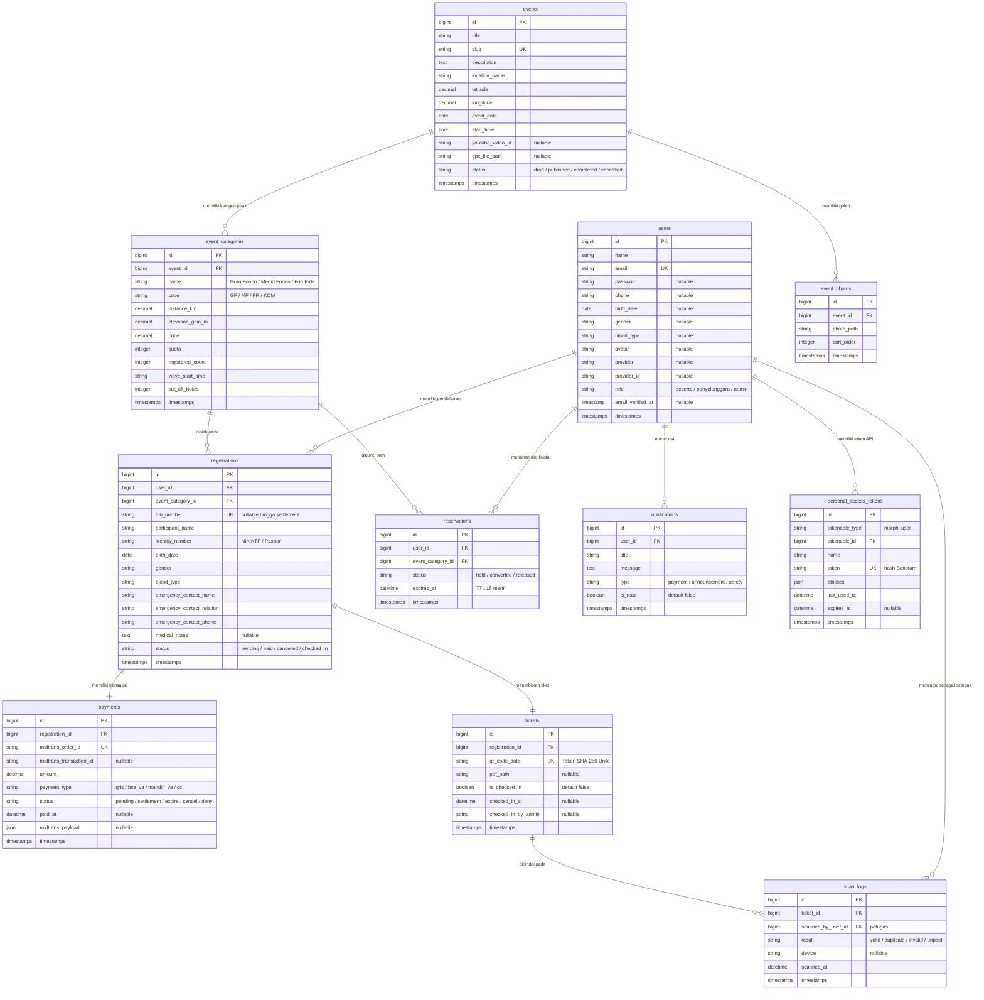

# Product Requirements Document (PRD) — Fitur, Layanan Third-Party, & Skema Basis Data
## Velosha: Platform Maraton & Balap Sepeda Indonesia

> **Dokumen:** Spesifikasi Fungsional Fitur, Integrasi Third-Party, Arsitektur Database (ERD), & Logika Bisnis  
> **Versi:** 2.2 (sinkron: matriks aktor 4 role, ERD + 3 tabel baru `reservations`/`scan_logs`/`personal_access_tokens`)  
> **File:** `Velosha/PRD/PRD-Fitur-Database.md`  
> **Stack:** Laravel 12 + Livewire 4 + SQLite/MySQL + Midtrans + Socialite + Pusher + Gemini/Groq  

---

## 1. Matriks Aktor Sistem & Hak Akses

Aplikasi Velosha melayani 4 tipe pengguna dengan peran dan otorisasi yang terdefinisi secara ketat (sesuai enum `users.role`: `peserta`, `penyelenggara`, `admin`; peran marshal di hari-H dijalankan oleh akun `penyelenggara`):

| Peran Aktor | Deskripsi Peran | Hak Akses Utama |
|---|---|---|
| **Tamu (Guest)** | Pengunjung umum yang belum masuk akun. | • Menjelajahi katalog maraton & kalender balap.<br>• Melihat detail rute, peta Google Maps, dan profil elevasi.<br>• Melakukan registrasi akun baru atau masuk lewat Social Login.<br>• Berinteraksi dengan chatbot AI seputar event. |
| **Peserta (Cyclist / Rider)** | Pengguna terdaftar dan terautentikasi (`role = peserta`). | • Mengisi formulir pendaftaran race (data pribadi & kontak medis darurat).<br>• Melakukan pembayaran instan via Midtrans Snap.<br>• Mengunduh E-Ticket PDF dan menyimpan jadwal ke Google Calendar.<br>• Mengakses Dashboard Peserta (status lunas, riwayat BIB, notifikasi balap). |
| **Penyelenggara (Race Director)** | Penyelenggara resmi event balap (`role = penyelenggara`). | • Manajemen CRUD Event: buat event, atur kategori tiket (kuota, harga, wave), publikasikan.<br>• Melihat daftar peserta per event, status pembayaran, dan ekspor CSV.<br>• Memantau KPI keterisian kuota dan omzet event.<br>• Mengakses Gate Scanner hari-H (peran marshal di lapangan).<br>• Mengirimkan notifikasi broadcast balap (info cuaca, RPC, dll). |
| **Admin (Platform)** | Pengelola sistem dan akun (`role = admin`). | • Manajemen user dengan role berbeda: tambah, edit, reset password, nonaktifkan.<br>• Memberi & mencabut akses panel penyelenggara.<br>• Super-visi seluruh event lintas penyelenggara dan moderasi publikasi.<br>• Laporan transaksi platform dan audit aktivitas akun. |

---

## 2. Rincian Fitur Fungsional & Integrasi Third-Party

```
┌────────────────────────────────────────────────────────────────────────┐
│                        FITUR APLIKASI VELOSHA                          │
└───────────────────────────────────┬────────────────────────────────────┘
                                    │
    ┌───────────────────────┬───────┴───────────────┬────────────────────┐
    ▼                       ▼                       ▼                    ▼
[EKSPLORASI RACE]    [CHECKOUT & PAY]        [E-TICKET & BIB]     [ADMIN & SCANNER]
• Katalog & Filter   • Form Data Medis       • Auto BIB Number    • CRUD Event
• Google Maps & GPX  • Midtrans Snap Pop-up  • QR Code Generator  • Real-time Scanner
• Profil Elevasi     • Socialite OAuth       • Google Calendar    • Export CSV
• Chatbot AI Gemini  • Notifikasi Pusher     • PDF E-Ticket       • Monitoring Kuota
```

### 2.1 Fitur 1: Eksplorasi & Filter Event Balap (Race Finder)
- **Multi-Parameter Filtering:** Pengguna dapat memfilter berdasarkan teks pencarian kota, dropdown kategori jarak (Gran Fondo 120KM+, Medio Fondo 60-90KM, Fun Ride, KOM Climb), bulan pelaksanaan, dan pengurutan (tanggal terdekat, elevasi tertinggi, harga terendah).
- **Penanganan State Tanpa Refresh:** Livewire mengontrol pencarian secara reaktif sehingga hasil kartu balap diperbarui tanpa memuat ulang seluruh halaman.
- **Data Densitas Kartu:** Menampilkan foto rute, sisa kuota tiket (*real-time indicator*), total elevasi, batas *cut-off time*, jumlah *aid stations*, dan harga mulai dari.

### 2.2 Fitur 2: Detail Event, Google Maps, & Profil Elevasi
- **Integrasi Google Maps API:** Embed peta interaktif yang memvisualisasikan sirkuit rute balap (misal: Borobudur loop 130KM) lengkap dengan penanda titik *Aid Station* (AS 1 hingga AS 4).
- **Unduh File GPX:** Tombol unduh file koordinat GPX resmi yang siap dimasukkan ke cyclocomputer peserta (Garmin, Wahoo, Bryton, Hammerhead).
- **Visualisasi Profil Elevasi (Elevation Chart):** Menampilkan profil kontur tanjakan vertikal dari titik terendah hingga titik tertinggi (*King of Mountain Sector*), persentase kemiringan rata-rata, dan gradien maksimal.
- **Jadwal Race Weekend:** Rincian jadwal kegiatan pengambilan *Race Pack* (H-2 & H-1) hingga rangkaian *Race Day* (pelepasan gelombang start wave 1 & wave 2).

### 2.3 Fitur 3: Autentikasi Ganda (Email/Password & Socialite OAuth)
- **Autentikasi Tradisional:** Registrasi dan login aman menggunakan alamat email, nomor telepon WhatsApp, dan password terenkripsi bcrypt.
- **Social Login Terintegrasi (Laravel Socialite):**
  - **Login with Google:** OAuth 2.0 sekali klik mengambil nama, email, dan avatar.
  - **Login with Facebook:** Integrasi Graph API untuk autentikasi cepat pesepeda.
  - **Login with TikTok:** Autentikasi Open API TikTok untuk menjangkau audiens generasi muda.
- **Keamanan Akun:** Menggunakan sesi database terenkripsi, proteksi CSRF di setiap formulir, dan pembatasan percobaan login (*rate limiting*).

### 2.4 Fitur 4: Formulir Pendaftaran & Validasi Data Medis
- **Progress Bar 3-Langkah:** Langkah 1 (Kategori Jarak) → Langkah 2 (Data Pribadi & Kontak Darurat) → Langkah 3 (Pembayaran).
- **Validasi Data Pribadi:** Validasi nama lengkap sesuai identitas resmi, nomor NIK KTP / Paspor, umur minimum 17 tahun pada tanggal race, jenis kelamin, dan golongan darah (A, B, AB, O).
- **Kontak Darurat Medis (Wajib & Kritis):** Mewajibkan pengisian nama wali/keluarga darurat, hubungan, dan nomor HP darurat aktif sebagai syarat penerbitan polis asuransi balap.
- **Reservasi Slot Sementara:** Sistem mengunci 1 kuota tiket selama 15 menit ketika peserta masuk ke langkah pembayaran untuk mencegah perebutan slot (*race condition*).

### 2.5 Fitur 5: Payment Gateway Midtrans (Snap Pop-up)
- **Pop-up Snap In-App:** Pembayaran diproses langsung di atas halaman aplikasi tanpa mengalihkan pengguna ke situs eksternal.
- **Kanal Pembayaran Didukung:**
  - **QRIS Real-time:** GoPay, OVO, ShopeePay, Dana, LinkAja, dan BCA QRIS.
  - **Virtual Account (VA):** BCA, Mandiri (Bill Payment), BRI, BNI, dan Permata.
  - **Kartu Kredit/Debit:** Visa, MasterCard, dan JCB dengan verifikasi 3D Secure (OTP).
- **Webhook Handler Idempoten:** Server menangani HTTP Postback Webhook dari Midtrans (`notification_handler`):
  - Saat `transaction_status == 'settlement'` atau `'capture'`: Ubah status pendaftaran ke `paid`, generate nomor BIB otomatis, buat record tiket QR, dan picu pengiriman email e-ticket.
  - Saat `transaction_status == 'expire'` atau `'cancel'`: Kembalikan kuota pendaftaran ke pool publik.

### 2.6 Fitur 6: Penomoran BIB Otomatis & Tiket QR Code
- **Format BIB Resmi:** Dihasilkan secara unik dengan algoritma konkurensi aman:
  - Format: `VLS-[KODE_KATEGORI]-[URUTAN_4_DIGIT]`
  - Contoh: `VLS-GF-0488` (Gran Fondo nomor 488), `VLS-MF-0102` (Medio Fondo nomor 102).
- **QR Code Enkripsi SHA-256:** Payload QR Code berisi hash string acak yang ditautkan dengan `ticket_id` di database:
  - Format: `VELOSHA-VERIFY-[HASH_TOKEN]-[BIB_NUMBER]`
  - Mencegah duplikasi atau pemalsuan tiket oleh pihak tidak bertanggung jawab.

### 2.7 Fitur 7: Integrasi Google Calendar
- **Sinkronisasi Jadwal Satu Klik:** Menghasilkan URL dinamis ke Google Calendar Web API:
  - Parameter otomatis terisi: Judul race, tanggal & jam pelepasan wave, cut-off time, lokasi titik koordinat sirkuit, dan nomor BIB peserta.

### 2.8 Fitur 8: Pengiriman E-Ticket PDF via Email
- **Notifikasi Email Transaksional:** Menggunakan Laravel Mail (Mailable class) dengan driver SMTP / Mailtrap.
- **Lampiran PDF Resmi:** Menghasilkan dokumen PDF berstandar cetak A4 yang memuat nomor BIB ukuran besar, QR Code resolusi tinggi, panduan pengambilan race pack, dan waiver hukum pernyataan kesehatan peserta.

### 2.9 Fitur 9: Notifikasi Real-time (Pusher / Laravel Echo)
- **Event Broadcasting:** Pengiriman update status secara langsung ke antarmuka pengguna tanpa refresh halaman:
  - Pop-up sukses saat pembayaran Midtrans terverifikasi.
  - Notifikasi pembaharuan jadwal pengambilan *race pack*.
  - Peringatan dini cuaca lintasan (*race day safety announcement*).

### 2.10 Fitur 10: Chatbot AI Cycling Strategist (Gemini / Groq API)
- **Asisten Percakapan Melayang:** Widget popover di sudut kanan bawah seluruh halaman.
- **Kemampuan AI:**
  - Menjawab panduan perbedaan elevasi Gran Fondo vs Medio Fondo.
  - Memberikan saran nutrisi sebelum dan selama race endurance.
  - Menjelaskan regulasi teknis UCI (larangan handlebar aero clip-on, kewajiban helm standar).
  - Mengecek status reservasi dan alur pengambilan nomor dada.

### 2.11 Fitur 11: Dashboard Peserta (Rider Portal)
- **Manajemen Tiket Saya:** Menampilkan daftar race yang diikuti, kartu tiket aktif (lunas) dengan akses cepat ke QR Code, dan tiket tertunda (pending).
- **Statistik Endurance Pribadi:** Total jarak kilometer race yang diikuti dan rekor nomor BIB.
- **Pembaruan Profil:** Fasilitas untuk mengubah nomor WhatsApp dan memverifikasi data kontak darurat.

### 2.12 Fitur 12: Dashboard Admin & CRUD Event
- **KPI Metrik Eksekutif:** 4 indikator performa utama: Total Peserta Terdaftar, Total Omzet Tiket, Jumlah Race Aktif, dan Total BIB Terbit.
- **CRUD Event Balap:** Fasilitas menambah event baru, mengunggah foto galeri, mengatur rute GPX, menentukan kuota per kategori, dan mempublikasikan status race.
- **Monitoring Kuota Real-Time:** Progress bar keterisian kuota per kategori lomba untuk mencegah *overbooking*.

### 2.13 Fitur 13: Ekspor Data Peserta (CSV / Excel)
- **Ekspor Dokumen Penyelenggara:** Mengunduh data lengkap peserta per event (Nama, NIK, Kategori, Golongan Darah, Kontak Darurat, Status Bayar) dalam format CSV/Excel untuk kebutuhan klaim asuransi dan pencetakan BIB fisik.

### 2.14 Fitur 14: Scanner QR Validasi Hari-H (Race Village Desk)
- **Pemindai Kamera Terintegrasi:** Memanfaatkan library JavaScript HTML5-QRCode untuk mengakses kamera perangkat panitia (*marshall*).
- **Verifikasi Instan:**
  - Status valid/lunas langsung muncul seketika saat QR Code terpindai.
  - Menampilkan foto peserta, NIK, wave corral start, dan instruksi penyerahan paket lomba fisik.
  - Mencegah tiket yang sama dipindai dua kali (*anti-double claim*).
- **Pencarian Manual BIB:** Kolom input darurat jika layar ponsel peserta retak atau tidak terbaca oleh lensa kamera.

---

## 3. Arsitektur Basis Data Lengkap

### 3.1 Skema Diagram Relasi Entitas (ERD)



> **Catatan konstrain:** (1) `registrations` memiliki unique compound `(user_id, event_category_id)` agar satu user tidak bisa mendaftar kategori yang sama dua kali; (2) `registrations.bib_number` diisi otomatis saat pembayaran `settlement` (sebelumnya NULL); (3) tabel `reservations`, `scan_logs`, dan `personal_access_tokens` menopang fitur **high concurrency**, **gate scanner**, dan **REST API** (lihat [PRD-Alur-dan-Penilaian.md](PRD-Alur-dan-Penilaian.md) bagian D & E) — belum ada di database.

---

### 3.2 Kamus Data & Definisi Kolom Tabel (Data Dictionary)

#### 1. Tabel: `users`
Menyimpan identitas seluruh pengguna aplikasi, baik peserta maupun admin.
| Nama Kolom | Tipe Data | Modifiers | Keterangan & Aturan |
|---|---|---|---|
| `id` | `BIGINT UNSIGNED` | `PRIMARY KEY, AUTO_INCREMENT` | Identifier unik pengguna |
| `name` | `VARCHAR(150)` | `NOT NULL` | Nama lengkap pengguna |
| `email` | `VARCHAR(191)` | `NOT NULL, UNIQUE` | Alamat email untuk login dan pengiriman tiket |
| `password` | `VARCHAR(255)` | `NULLABLE` | Password hash bcrypt. Null jika login via Socialite |
| `phone` | `VARCHAR(30)` | `NULLABLE` | Nomor WhatsApp aktif |
| `birth_date` | `DATE` | `NULLABLE` | Tanggal lahir peserta |
| `gender` | `ENUM('male','female')` | `NULLABLE` | Jenis kelamin |
| `blood_type` | `ENUM('A','B','AB','O')`| `NULLABLE` | Golongan darah untuk catatan medis darurat |
| `avatar` | `VARCHAR(255)` | `NULLABLE` | Path file atau URL foto profil |
| `provider` | `VARCHAR(50)` | `NULLABLE` | Provider Socialite: `google`, `facebook`, `tiktok` |
| `provider_id`| `VARCHAR(191)` | `NULLABLE` | ID unik dari provider pihak ketiga |
| `role` | `ENUM('peserta','penyelenggara','admin')`| `DEFAULT 'peserta'` | Hak akses pengguna di sistem (penyelenggara mencakup Race Director & Marshal) |
| `created_at` | `TIMESTAMP` | `NULLABLE` | Waktu registrasi akun |
| `updated_at` | `TIMESTAMP` | `NULLABLE` | Waktu pembaruan akun |

#### 2. Tabel: `events`
Menyimpan master data event maraton sepeda yang dikurasi oleh tim Velosha.
| Nama Kolom | Tipe Data | Modifiers | Keterangan |
|---|---|---|---|
| `id` | `BIGINT UNSIGNED` | `PRIMARY KEY, AUTO_INCREMENT` | Identifier unik event |
| `title` | `VARCHAR(200)` | `NOT NULL` | Judul event (contoh: Gran Fondo Borobudur 2026) |
| `slug` | `VARCHAR(200)` | `NOT NULL, UNIQUE` | URL ramah SEO (`velosha-borobudur-marathon`) |
| `description` | `TEXT` | `NOT NULL` | Deskripsi rute, tantangan, dan aturan teknis |
| `location_name`| `VARCHAR(200)` | `NOT NULL` | Nama kota dan provinsi lokasi race |
| `latitude` | `DECIMAL(10,8)` | `NOT NULL` | Koordinat lintang untuk Google Maps embed |
| `longitude` | `DECIMAL(11,8)` | `NOT NULL` | Koordinat bujur untuk Google Maps embed |
| `event_date` | `DATE` | `NOT NULL` | Tanggal pelaksanaan race day |
| `start_time` | `TIME` | `NOT NULL` | Waktu mulai start gate dibuka (contoh: 05:45:00) |
| `youtube_video_id` | `VARCHAR(50)` | `NULLABLE` | ID video teaser YouTube (contoh: `dQw4w9WgXcQ`) |
| `gpx_file_path` | `VARCHAR(255)` | `NULLABLE` | Path penyimpanan file rute koordinat GPX |
| `status` | `ENUM(...)` | `DEFAULT 'published'`| Pilihan: `draft`, `published`, `completed`, `cancelled` |
| `created_at` | `TIMESTAMP` | `NULLABLE` | Waktu pembuatan event |
| `updated_at` | `TIMESTAMP` | `NULLABLE` | Waktu pembaruan event |

#### 3. Tabel: `event_categories`
Menyimpan kategori jarak dan harga tiket di dalam suatu event.
| Nama Kolom | Tipe Data | Modifiers | Keterangan |
|---|---|---|---|
| `id` | `BIGINT UNSIGNED` | `PRIMARY KEY, AUTO_INCREMENT` | Identifier unik kategori |
| `event_id` | `BIGINT UNSIGNED` | `NOT NULL, FOREIGN KEY` | Menunjuk ke `events.id` (ON DELETE CASCADE) |
| `name` | `VARCHAR(100)` | `NOT NULL` | Nama kategori (Gran Fondo, Medio Fondo, Fun Ride) |
| `code` | `VARCHAR(10)` | `NOT NULL` | Kode kategori untuk BIB (`GF`, `MF`, `FR`, `KOM`) |
| `distance_km` | `DECIMAL(6,2)` | `NOT NULL` | Jarak tempuh dalam kilometer (contoh: 130.00) |
| `elevation_gain_m` | `DECIMAL(6,2)`| `NOT NULL` | Total akumulasi elevasi tanjakan (contoh: 1450.00) |
| `price` | `DECIMAL(12,2)` | `NOT NULL` | Biaya pendaftaran per orang (contoh: 500000.00) |
| `quota` | `INTEGER` | `NOT NULL` | Batas maksimum peserta yang diizinkan |
| `registered_count` | `INTEGER` | `DEFAULT 0` | Jumlah pendaftar aktif saat ini |
| `wave_start_time` | `VARCHAR(50)` | `NOT NULL` | Gelombang start (contoh: Wave 1 - 05:45 WIB) |
| `cut_off_hours` | `DECIMAL(4,2)` | `NOT NULL` | Batas waktu tempuh maksimal (contoh: 7.00 Jam) |

#### 4. Tabel: `registrations`
Menyimpan pendaftaran spesifik peserta pada suatu kategori race, beserta data medis darurat.
| Nama Kolom | Tipe Data | Modifiers | Keterangan |
|---|---|---|---|
| `id` | `BIGINT UNSIGNED` | `PRIMARY KEY, AUTO_INCREMENT` | Identifier pendaftaran |
| `user_id` | `BIGINT UNSIGNED` | `NOT NULL, FOREIGN KEY` | Menunjuk ke `users.id` |
| `event_category_id` | `BIGINT UNSIGNED` | `NOT NULL, FOREIGN KEY` | Menunjuk ke `event_categories.id` |
| `bib_number` | `VARCHAR(30)` | `NULLABLE, UNIQUE` | Nomor dada resmi (contoh: `VLS-GF-0488`). Diisi otomatis saat pembayaran `settlement`; NULL selama menunggu bayar. Unique compound lain: `(user_id, event_category_id)` anti daftar dobel |
| `participant_name` | `VARCHAR(150)` | `NOT NULL` | Nama peserta sesuai identitas KTP |
| `identity_number` | `VARCHAR(50)` | `NOT NULL` | NIK KTP atau nomor Paspor peserta |
| `birth_date` | `DATE` | `NOT NULL` | Tanggal lahir peserta |
| `gender` | `ENUM('male','female')` | `NOT NULL` | Jenis kelamin |
| `blood_type` | `ENUM('A','B','AB','O')`| `NOT NULL` | Golongan darah |
| `emergency_contact_name` | `VARCHAR(150)` | `NOT NULL` | Nama kontak darurat wajib |
| `emergency_contact_relation`| `VARCHAR(50)` | `NOT NULL` | Hubungan keluarga (Istri, Suami, Orang Tua) |
| `emergency_contact_phone` | `VARCHAR(30)` | `NOT NULL` | Nomor telepon kontak darurat |
| `medical_notes` | `TEXT` | `NULLABLE` | Riwayat alergi obat atau riwayat sakit |
| `status` | `ENUM(...)` | `DEFAULT 'pending'` | Pilihan: `pending`, `paid`, `cancelled`, `checked_in` |
| `created_at` | `TIMESTAMP` | `NULLABLE` | Waktu transaksi diajukan |
| `updated_at` | `TIMESTAMP` | `NULLABLE` | Waktu perubahan status |

#### 5. Tabel: `payments`
Menyimpan transaksi finansial yang dikomunikasikan dengan gateway Midtrans.
| Nama Kolom | Tipe Data | Modifiers | Keterangan |
|---|---|---|---|
| `id` | `BIGINT UNSIGNED` | `PRIMARY KEY, AUTO_INCREMENT` | Identifier transaksi internal |
| `registration_id` | `BIGINT UNSIGNED` | `NOT NULL, FOREIGN KEY` | Menunjuk ke `registrations.id` |
| `midtrans_order_id` | `VARCHAR(100)` | `NOT NULL, UNIQUE` | Order ID Midtrans (`VLS-2026-GF0488`) |
| `midtrans_transaction_id`| `VARCHAR(100)` | `NULLABLE` | Transaction ID resmi dari Midtrans |
| `amount` | `DECIMAL(12,2)` | `NOT NULL` | Total tagihan pendaftaran |
| `payment_type` | `VARCHAR(50)` | `NULLABLE` | Tipe bayar: `qris`, `bank_transfer`, `credit_card` |
| `status` | `ENUM(...)` | `DEFAULT 'pending'` | Pilihan: `pending`, `settlement`, `expire`, `cancel` |
| `paid_at` | `DATETIME` | `NULLABLE` | Waktu dana berhasil masuk (settlement) |
| `midtrans_payload` | `JSON` | `NULLABLE` | Rekaman respon JSON mentah dari Webhook Midtrans |

#### 6. Tabel: `tickets`
Menyimpan e-ticket digital resmi dan status check-in verifikasi hari-H.
| Nama Kolom | Tipe Data | Modifiers | Keterangan |
|---|---|---|---|
| `id` | `BIGINT UNSIGNED` | `PRIMARY KEY, AUTO_INCREMENT` | Identifier unik tiket |
| `registration_id` | `BIGINT UNSIGNED` | `NOT NULL, FOREIGN KEY` | Menunjuk ke `registrations.id` |
| `qr_code_data` | `VARCHAR(255)` | `NOT NULL, UNIQUE` | String token enkripsi untuk isi QR Code |
| `pdf_path` | `VARCHAR(255)` | `NULLABLE` | Lokasi file PDF E-Ticket tersimpan di server |
| `is_checked_in` | `BOOLEAN` | `DEFAULT false` | Status apakah race pack sudah diambil |
| `checked_in_at` | `DATETIME` | `NULLABLE` | Waktu pengambilan fisik race pack di Race Village |
| `checked_in_by_admin` | `VARCHAR(150)`| `NULLABLE` | Nama atau ID marshall yang memindai QR |

#### 7. Tabel: `notifications`
Menyimpan notifikasi real-time yang disiarkan melalui Pusher ke portal peserta.
| Nama Kolom | Tipe Data | Modifiers | Keterangan |
|---|---|---|---|
| `id` | `BIGINT UNSIGNED` | `PRIMARY KEY, AUTO_INCREMENT` | Identifier unik notifikasi |
| `user_id` | `BIGINT UNSIGNED` | `NOT NULL, FOREIGN KEY` | Penerima notifikasi |
| `title` | `VARCHAR(150)` | `NOT NULL` | Judul notifikasi |
| `message` | `TEXT` | `NOT NULL` | Isi pesan |
| `type` | `VARCHAR(50)` | `DEFAULT 'announcement'`| Pilihan: `payment`, `announcement`, `safety` |
| `is_read` | `BOOLEAN` | `DEFAULT false` | Status telah dibaca |
| `created_at` | `TIMESTAMP` | `NULLABLE` | Waktu pengiriman notifikasi |

#### 8. Tabel: `reservations`
Mengunci 1 slot kuota selama 15 menit ketika peserta memasuki tahap pembayaran — inti strategi **high concurrency** (lihat [PRD-Alur-dan-Penilaian.md](PRD-Alur-dan-Penilaian.md) bagian E). *Status: belum dibuat.*
| Nama Kolom | Tipe Data | Modifiers | Keterangan |
|---|---|---|---|
| `id` | `BIGINT UNSIGNED` | `PRIMARY KEY, AUTO_INCREMENT` | Identifier reservasi |
| `user_id` | `BIGINT UNSIGNED` | `NOT NULL, FOREIGN KEY` | Peserta pemegang slot |
| `event_category_id` | `BIGINT UNSIGNED` | `NOT NULL, FOREIGN KEY` | Kategori tiket yang dikunci |
| `status` | `ENUM('held','converted','released')` | `DEFAULT 'held'` | `held` = slot terkunci, `converted` = jadi pendaftaran lunas, `released` = slot dilepas |
| `expires_at` | `DATETIME` | `NOT NULL` | Batas waktu 15 menit; job terjadwal melepas & mengembalikan kuota bila lewat |
| `created_at` / `updated_at` | `TIMESTAMP` | `NULLABLE` | Timestamp |

#### 9. Tabel: `scan_logs`
Audit setiap pemindaian tiket di Gate Scanner hari-H (menopang fitur **gate scanner** & anti pindai ganda). *Status: belum dibuat.*
| Nama Kolom | Tipe Data | Modifiers | Keterangan |
|---|---|---|---|
| `id` | `BIGINT UNSIGNED` | `PRIMARY KEY, AUTO_INCREMENT` | Identifier log |
| `ticket_id` | `BIGINT UNSIGNED` | `NOT NULL, FOREIGN KEY` | Tiket yang dipindai |
| `scanned_by_user_id` | `BIGINT UNSIGNED` | `NOT NULL, FOREIGN KEY` | Petugas (akun `penyelenggara`/`admin`) |
| `result` | `ENUM('valid','duplicate','invalid','unpaid')` | `NOT NULL` | Hasil verifikasi pemindaian |
| `device` | `VARCHAR(100)` | `NULLABLE` | Identitas perangkat petugas (tablet/kamera) |
| `scanned_at` | `DATETIME` | `NOT NULL` | Waktu pemindaian |
| `created_at` / `updated_at` | `TIMESTAMP` | `NULLABLE` | Timestamp |

#### 10. Tabel: `personal_access_tokens`
Token autentikasi **REST API** via Laravel Sanctum (bawaan package — dibuat saat `php artisan install:api`). *Status: belum dibuat.*
| Nama Kolom | Tipe Data | Modifiers | Keterangan |
|---|---|---|---|
| `id` | `BIGINT UNSIGNED` | `PRIMARY KEY, AUTO_INCREMENT` | Identifier token |
| `tokenable_type` | `VARCHAR(255)` | `NOT NULL` | Polymorphic: `App\Models\User` |
| `tokenable_id` | `BIGINT UNSIGNED` | `NOT NULL, FOREIGN KEY` | `users.id` pemilik token |
| `name` | `VARCHAR(255)` | `NOT NULL` | Label perangkat/klien (mis. `gate-scanner-racevillage`) |
| `token` | `VARCHAR(64)` | `NOT NULL, UNIQUE` | Hash token (token asli hanya dikirim sekali saat login) |
| `abilities` | `JSON` | `NULLABLE` | Hak akses token (`['*']`) |
| `last_used_at` | `TIMESTAMP` | `NULLABLE` | Pemakaian terakhir |
| `expires_at` | `TIMESTAMP` | `NULLABLE` | Kedaluwarsa token |
| `created_at` / `updated_at` | `TIMESTAMP` | `NULLABLE` | Timestamp |

---

## 4. Logika Bisnis Kunci (Business Logic Rules)

### 4.1 State Machine Transaksi Pembayaran
```
               ┌───────────────┐
               │    PENDING    │
               │ (Slot locked) │
               └───────┬───────┘
                       │
         ┌─────────────┴─────────────┐
         ▼                           ▼
┌─────────────────┐         ┌─────────────────┐
│   SETTLEMENT    │         │     EXPIRE      │
│  (Status PAID)  │         │ (Slot released) │
├─────────────────┤         ├─────────────────┤
│• Generate BIB   │         │• Batal order    │
│• Terbitkan QR   │         │• Kembalikan kuota│
│• Kirim E-Ticket │         └─────────────────┘
└────────┬────────┘
         │
         ▼
┌─────────────────┐
│   CHECKED-IN    │
│ (Hari-H Race)   │
├─────────────────┤
│• Serah BIB fisik│
│• Serah RFID Chip│
└─────────────────┘
```

1. **Inisiasi (Pending):** Saat form pendaftaran di-submit, sistem mengunci 1 kuota dan membuat record transaksi dengan masa kedaluwarsa 15 menit.
2. **Pembayaran Sukses (Settlement):** Webhook Midtrans mengirim konfirmasi. Sistem menjalankan prosedur idempoten:
   - Validasi status transaksi sebelumnya agar tidak terjadi dobel eksekusi.
   - Panggil helper `generateBibNumber(event_category_id)`.
   - Simpan nomor BIB unik ke tabel `registrations`.
   - Buat record tiket pada tabel `tickets` dengan QR token acak aman.
   - Picu event `TicketIssued` untuk mengirimkan PDF ke email peserta.
3. **Kedaluwarsa (Expire/Cancel):** Jika batas waktu 15 menit terlampaui tanpa pembayaran, kuota tiket dikembalikan ke pool dan pendaftaran dibatalkan otomatis.

### 4.2 Prosedur Anti Double-Claim Check-in Hari-H
1. Kamera scanner membaca QR Token dari ponsel peserta.
2. Query ke tabel `tickets` mencari token yang cocok.
3. **Pengecekan Keabsahan:**
   - Jika tiket tidak ditemukan: Tampilkan pesan merah *"TIKET TIDAK TERDAFTAR"*.
   - Jika `is_checked_in == true`: Tampilkan peringatan merah *"TIKET SUDAH DIGUNAKAN"* beserta waktu dan nama petugas pemindai sebelumnya untuk mencegah kecurangan.
   - Jika `is_checked_in == false` dan status pendaftaran `paid`: Tampilkan kartu hijau *"TIKET VALID & LUNAS"*, tampilkan rincian peserta, dan aktifkan tombol *"Konfirmasi Serahkan Race Pack"*.
4. Saat petugas menekan tombol konfirmasi, ubah `is_checked_in = true` dan catat `checked_in_at = NOW()`.
