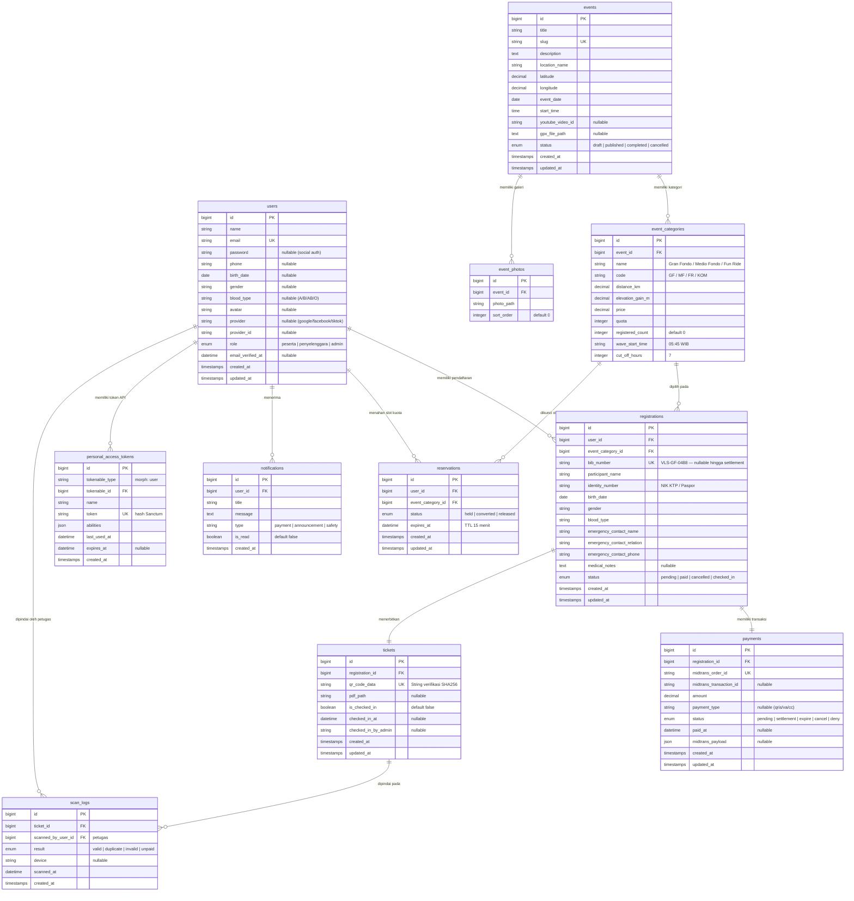

# Product Requirements Document (PRD) — Velosha
## Platform Ticketing & Manajemen Maraton Sepeda Indonesia

> **Nama Aplikasi:** Velosha (Velo + Jitensha / 自転車)  
> **Versi:** 2.4 (Terbaru & Konsolidasi Lengkap)  
> **Lokasi File:** `Velosha/PRD/PRD-Velosha.md`  
> **Tech Stack:** Laravel 12 + Livewire 4 + Tailwind CSS + Vite (panel admin: Filament 5, auth: Laravel Breeze)  
> **Database:** MySQL (database `velosha`, user `root`, tanpa password — default XAMPP). PHPUnit tetap memakai SQLite in-memory agar test cepat dan tidak bergantung pada server DB.  
> **Palet Warna:** Empat warna inti yang telah disetujui — **Amber Race `#DE7119`** (warna aksi), **Warm Gray `#DEE3E2`** (latar aplikasi), **Dark Teal `#116979`** (warna teks & panel gelap), dan **Light Teal `#18B0B0`** (dekoratif saja). Tombol solid memakai shade aksesibel `#B2590F` karena putih di atas `#DE7119` hanya 3.24:1. Palet Deep Navy dan abu-abu Tailwind telah dihapus.  
> **Logo:** Monogram resmi hasil crop (nama "VELOSHA" dihapus) di `public/images/logo-velosha.jpg`.  
> **Metode Pengembangan:** Frontend First (Semua antarmuka dibangun statis & tervalidasi visual, disusul logika backend & integrasi third-party).  
> **Kriteria Penilaian Portofolio:** 12 kriteria (Identifikasi Masalah, Arsitektur, REST API, Auth, Landing Page, Detail Event, Pemilihan Tiket, Checkout, Responsive Desain, Payment Concept, High Concurrency, Gate Scanner) beserta rancangan alur lengkap ada di **[PRD-Alur-dan-Penilaian.md](PRD-Alur-dan-Penilaian.md)**.

---

## 1. Ringkasan Eksekutif & Identitas Produk

### 1.1 Latar Belakang & Filosofi Nama
**Velosha** menggabungkan istilah sepeda internasional *"Velo"* (bahasa Prancis untuk sepeda/kecepatan) dengan akhiran *"-sha"* yang diambil dari kata *"Jitensha"* (自転車 — sepeda dalam bahasa Jepang). Aplikasi ini dirancang sebagai platform kurasi, registrasi, dan manajemen maraton sepeda jalan raya (*road bike endurance*), *Gran Fondo*, dan *cycling event* resmi di Indonesia.

### 1.2 Masalah yang Diselesaikan (Identifikasi Masalah)
Identifikasi masalah disusun dari keresahan nyata pengguna platform pendaftaran balap yang ada saat ini (analisis lengkap + dampak & solusi: [PRD-Alur-dan-Penilaian.md bagian B](PRD-Alur-dan-Penilaian.md)):

1. **Server down saat pendaftaran dibuka serentak.** Pendaftaran yang dibuka pada satu jam bersamaan membuat server tumbang karena lonjakan pengunjung — peserta kehilangan slot dan kepercayaan turun. *Solusi: strategi high concurrency — pengurangan kuota atomik, kunci slot 15 menit, antrean webhook, dan rate limit (lihat PRD-Alur-dan-Penilaian.md bagian E).*
2. **UI/UX yang kurang nyaman dipandang.** Tampilan platform yang padat dan tidak terstruktur membuat pengguna ragu melanjutkan pendaftaran. *Solusi: design system ketat — radius 1px/3px tanpa kapsul, 4 warna inti, kontras WCAG AA, teks editorial yang ringkas (bagian 3).*
3. **Pendaftaran tersebar lewat DM/WA di Facebook & Instagram.** Penyelenggara yang menerima pendaftaran via pesan membuat data tercecer, konfirmasi manual, salah transfer, dan double booking. *Solusi: satu alur end-to-end di website — katalog → pilih tiket → form tervalidasi → pembayaran resmi → e-ticket QR otomatis.*
4. **Wajib mengunduh aplikasi pihak ketiga.** Platform yang ada mengharuskan instalasi aplikasi (contoh: [mainsepeda.com](https://www.mainsepeda.com/)) hanya untuk mendaftar satu event. *Solusi: Velosha 100% web — responsif di browser ponsel/tablet/desktop tanpa instalasi.*
5. **Gagal proses verifikasi akun.** Pengguna terkunci dari akunnya akibat alur verifikasi aplikasi yang rumit (contoh kasus: [laporan gagal verifikasi](https://www.mainsepeda.com/r/5041/gagal-verifikasi-mainsepeda-app-no-worries-ini-solusinya)) sehingga batal mendaftar. *Solusi: autentikasi Breeze yang transparan — login, reset password jelas, pesan error dapat ditindaklanjuti, plus social login mode demo sebagai jalur alternatif.*

---

## 2. Analisis & Adopsi 3 Referensi Utama

| Referensi | URL | Elemen yang Diadopsi untuk Velosha | Elemen yang Dieliminasi |
|---|---|---|---|
| **GFNY World (Race Finder)** | [gfny.com/race-finder](https://gfny.com/race-finder/?fwp_race_finder_event_type=cycling&fwp_race_finder_locations=indonesia) | • Struktur data race: Tanggal, kota, jarak, elevasi, dan cutoff time.<br>• Peta rute sirkuit balap dengan titik aid stations.<br>• Sistem penomoran BIB resmi per kategori. | • Warna hijau neon mencolok diganti palet Deep Navy & Racing Orange yang elegan.<br>• Menu berlebihan (shop, franchise, dll) disederhanakan. |
| **NOMADICT** | [nomadict.org](https://nomadict.org/) | • Gaya editorial visual: Foto aksi pebalap besar beresolusi tinggi.<br>• Banyak *white space* dan tipografi tenang/bersih.<br>• Desain yang tidak terasa padat seperti media sosial. | • Format majalah/artikel blog panjang.<br>• Widget sidebar dan iklan banner. |
| **Airbnb Experiences** | [airbnb.co.id/s/experiences](https://www.airbnb.co.id/s/experiences) | • Filter kategori horizontal (*Category Tabs*).<br>• Card informasi padat data: Foto, lokasi, rating/status, jarak, dan harga transparan.<br>• Bar pencarian ergonomis dengan filter lokasi dan waktu. | • Sistem dynamic pricing rumit.<br>• Review bintang multi-level yang tidak relevan dengan tiket balap. |

---

## 3. Panduan Desain & UI/UX (Design System)

### 3.1 Aturan Border Radius (Strict Geometric System)
- **Komponen Utama (1px):** Kontainer kartu terluar (`card-outer`), tombol utama/sekunder (`btn-primary`), form input, modal pop-up, dan navbar menggunakan **`border-radius: 1px`** (`velo-box-1`).
- **Komponen Bersarang (3px):** Elemen di dalam kartu seperti badge kategori, tag jarak, thumbnail galeri, dan chip spesifikasi menggunakan **`border-radius: 3px`** (`velo-box-3`).
- **Dilarang:** Tombol kapsul (*capsule pill* / `rounded-full`). Tampilan wajib bernuansa tajam, presisi, dan arsitektural.

### 3.2 Palet Warna (Light Mode — Oranye + Abu-abu)
Aplikasi hanya memakai dua warna: Racing Orange untuk elemen interaktif, dan skala abu-abu untuk teks serta permukaan.

| Peran Warna | Kode HEX | Deskripsi Visual & Penggunaan |
|---|---|---|
| **Background Utama** | `#FFFFFF` | Putih bersih untuk navbar dan seluruh kartu |
| **Background Aplikasi** | `#DEE3E2` | Warm gray untuk `<body>`, memisahkan kartu putih dari halaman |
| **Background Sekunder** | `#F1F4F4` | Section bergaltet, legend, dan info box |
| **Teks Utama (Dark Teal)** | `#116979` | Warna teks utama: judul, heading, label, dan panel gelap |
| **Ink Gelap** | `#0A353E` – `#0E7C7E` | Judul besar dan angka statistik dengan kontras maksimum |
| **Teks Sekunder/Muted** | `#556066` / `#5F6A70` | Metadata, subtitle, caption, dan label sekunder |
| **Border & Divider** | `#D5D9D8` / `#B8BFBE` | Garis tipis 1px pembatas elemen; strong untuk focus state |
| **Aksen Amber (Signature)** | `#DE7119` | Border kartu pilihan, checkbox/radio aktif, aksen dekoratif |
| **Tombol Solid (Aksesibel)** | `#B2590F` | **Latar semua tombol solid + teks putih** — 4.85:1, memenuhi WCAG AA |
| **Tombol Hover** | `#A0520C` | State hover tombol solid |
| **Aksen Tint (Amber)** | `#FDF3E9` | Latar lembut untuk ikon/badge beraksen amber |
| **Light Teal (Dekoratif)** | `#18B0B0` | **Dilarang untuk teks.** Hanya dot, garis, dan pattern grid |
| **Panel Gelap** | `#116979` / `#0A1F24` | Topbar, chatbot, kartu E-Ticket, dan overlay auth |
| **Status Sukses/Lunas** | `#065F46` / `#ECFDF5` | Hijau botol tua untuk status "Lunas" & "Verified" |
| **Status Pending** | `#A0520C` / `#FDF3E9` | Amber gelap untuk "Menunggu Pembayaran" |
| **Status Darurat/Medis**| `#991B1B` / `#FEF2F2` | Merah tua untuk kontak darurat & golongan darah |

> Deep Navy `#1E3A5F` telah dihapus dari sistem desain.

### 3.3 Tipografi
- **Font Family:** `Inter` (Google Fonts), fallback `system-ui, sans-serif`.
- **Heading 1:** 36px - 48px / Font Weight 800 - 900 / Tracking -0.02em.
- **Heading 2:** 24px - 30px / Font Weight 700.
- **Heading 3:** 18px - 20px / Font Weight 600.
- **Body Text:** 14px - 16px / Line Height 1.6 / Font Weight 400.
- **Data/Kode BIB:** Font Monospace (`font-mono`) / Font Weight 700.

---

## 4. Arsitektur Halaman & Sitemap (9 Halaman)

```
                    ┌────────────────────────┐
                    │  1. Beranda / Home     │
                    │         (/)            │
                    └───────────┬────────────┘
                                │
        ┌───────────────────────┼───────────────────────┐
        ▼                       ▼                       ▼
┌───────────────┐       ┌───────────────┐       ┌───────────────┐
│ 2. Katalog    │       │ 4. Auth       │       │ 10. AI Bot    │
│    Race       │       │ (/login)      │       │ (Floating     │
│  (/events)    │       │ (/register)   │       │  Assistant)   │
└───────┬───────┘       └───────┬───────┘       └───────────────┘
        │                       │
        ▼                       ▼
┌───────────────┐       ┌───────────────┐
│ 3. Detail     │       │ 7. Dashboard  │
│    Event      │       │    Peserta    │
│ (/events/{id})│       │ (/dashboard)  │
└───────┬───────┘       └───────────────┘
        │
        ▼
┌───────────────┐
│ 5. Formulir   │
│    Checkout   │
│  (/checkout)  │
└───────┬───────┘
        │
        ▼
┌───────────────┐
│ 6. E-Ticket   │
│  & BIB Resmi  │
│   (/ticket)   │
└───────────────┘
        │
        ▼
┌──────────────────────────────────────────────┐
│ PANEL ADMIN PENYELENGGARA                    │
│ 8. Dashboard Admin (/admin)                  │
│ 9. Scanner QR Check-in Hari-H (/admin/scan)  │
└──────────────────────────────────────────────┘
```

### 4.1 Spesifikasi Per Halaman

#### Halaman 1: Beranda (Landing Page) — `/`
- **Nama Section Katalog:** section daftar race saat ini berlabel **"Race Mendatang"** (`resources/views/livewire/race-cards.blade.php:22`) dan dijadwalkan diganti menjadi **"Pendaftaran Terbuka & Mendatang"** — mencakup event yang pendaftarannya masih terbuka dan yang akan datang (lihat [PRD-Alur-dan-Penilaian.md bagian F](PRD-Alur-dan-Penilaian.md)).
- **Hero Section:** Menggunakan foto peleton maraton asli (`public/images/hero-peloton.jpg`), judul tajam tanpa badge bertumpuk, overlay gelap `#0A1F24`, tombol CTA amber aksesibel (`#B2590F`) dan putih transparan, serta metrik ringkas (12 Race, 8.500+ Cyclist, 1.820 KM Rute, 100% RFID & Medis).
- **Bar Filter Cepat:** Tab kategori jarak horizontal bergaya Airbnb (Semua, Gran Fondo 120KM+, Medio Fondo 60-90KM, Fun Ride, KOM Climb) + pencarian kota.
- **Grid Race Pilihan:** Card 3 kolom dengan foto tajam, tag kategori (3px), tanggal, kota, jarak tempuh, chip spesifikasi (elevasi, COT, feed zone), dan harga mulai.
- **Peta Rute Interaktif (Google Maps):** Embed sirkuit rute Borobudur dengan penanda 4 pos hidrasi (*feed zones*).
- **Profil Elevasi SVG:** Grafik kontur tanjakan Sektor Menoreh (min 230m ASL, peak 920m ASL).
- **Video Teaser 16:9:** Embed YouTube resmi dokumentasi balap musim sebelumnya.
- **Standar Keselamatan & Fasilitas:** 4 kartu (RFID timing chip, medali cor logam, asuransi kecelakaan, recovery lunch).
- **FAQ:** Akordeon informasi kualifikasi sepeda, batasan usia, dan pengambilan race pack.

#### Halaman 2: Katalog Event (Race Finder) — `/events`
- **Filter Multi-Parameter:** Filter pencarian teks kota, dropdown kategori jarak, filter bulan pelaksanaan, dan opsi pengurutan (*sorting*).
- **Hasil Event:** Grid 6 kartu event resmi terkurasi (Gran Fondo Borobudur, Bromo Summit KOM, Bali Coastal Fondo, Lombok Mandalika, Bandung Highland, Jogja Royal Heritage).
- **Tag Filter Aktif:** Indikator filter yang sedang diterapkan dengan tombol reset cepat.
- **Paginasi:** Navigasi halaman 1px geometris.

#### Halaman 3: Detail Event & Profil Rute — `/events/{slug}`
- **Galeri Foto:** 1 foto utama resolusi tinggi + grid 4 foto sekunder (tanjakan, aid station, pesawahan, medali).
- **Info Race:** Tanggal, waktu start (*Wave Start* 05:45 WIB), lokasi, status akreditasi UCI.
- **Deskripsi & Karakteristik Medan:** Penjelasan teknis rute aspal *hotmix*, angin, dan titik kritis tanjakan.
- **Peta Interaktif & GPX:** Google Maps rute loop 130KM + tombol unduh file GPX untuk Garmin/Wahoo/Bryton.
- **Grafik Elevasi Interaktif:** Elevasi tanjakan per kilometer beserta titik King of Mountain (KOM).
- **Jadwal Race Weekend:** Timeline H-2 Race Pack Collection (RPC) dan Hari-H Race Day.
- **Sticky Booking Sidebar:** Pilihan kategori jarak radio card, indikator sisa slot kuota, rincian fasilitas termasuk, dan tombol checkout pendaftaran.

#### Halaman 4: Login & Registrasi Peserta — `/login` & `/register`
- **Split Layout:** Foto editorial pebalap di sisi kiri (50%) + formulir interaktif di sisi kanan (50%).
- **Social Login:** 3 tombol vertikal kotak 1px: **Google**, **Facebook**, dan **TikTok** lengkap dengan logo SVG resmi.
- **Formulir Masuk:** Email, kata sandi, checkbox "Ingat Sesi", dan link lupa sandi.
- **Formulir Pendaftaran:** Nama lengkap sesuai KTP, email aktif, nomor WhatsApp (untuk notifikasi race), kata sandi & konfirmasi.
- **Tab Switcher:** Toggle instan Masuk ↔ Daftar tanpa reload halaman.

#### Halaman 5: Formulir Pendaftaran & Checkout — `/checkout`
- **Indikator 3-Langkah:** (1) Kategori Race → (2) Data Diri & Medis → (3) Pembayaran Midtrans.
- **Data Diri Peserta:** Nama lengkap, NIK KTP / Paspor, tanggal lahir (validasi umur minimum 17 tahun), jenis kelamin, golongan darah (A, B, AB, O).
- **Data Medis & Kontak Darurat (Wajib):** Nama kontak darurat, hubungan keluarga, nomor HP darurat, dan riwayat alergi obat/makanan.
- **Ringkasan Pembayaran:** Harga tiket, sewa RFID gratis, premi asuransi resmi, dan biaya layanan.
- **Simulasi Pop-up Midtrans Snap:** Modal pembayaran dengan pilihan QRIS (GoPay, OVO, ShopeePay, Dana) dan Virtual Account bank otomatis.

#### Halaman 6: Konfirmasi Pembayaran & E-Ticket — `/ticket`
- **Banner Status:** Ikon centang hijau besar bertuliskan *"Pembayaran Terverifikasi Lunas"*.
- **Card E-Ticket Presisi:** 
  - Header navy gelap dengan logo Velosha dan nomor order.
  - **Nomor BIB Besar & Bold:** `VLS-GF-0488`.
  - **QR Code Unik:** QR resolusi tinggi untuk pemindaian saat penukaran race pack.
  - Data spesifikasi: Nama peserta, kategori jarak, wave corral A, golongan darah O+, klub sepeda.
- **Aksi Cepat:** Tombol simpan langsung ke **Google Calendar**, tombol unduh **PDF**, dan tombol buka portal dashboard.

#### Halaman 7: Dashboard Peserta (Rider Portal) — `/dashboard`
- **Profil Cyclist:** Avatar geometris, status *Verified Rider*, email, kontak WhatsApp, dan nama komunitas/klub.
- **4 Kartu Metrik Pribadi:** Tiket terkonfirmasi, total kilometer endurance, status pembayaran 100% lunas, dan nomor BIB aktif.
- **Daftar Tiket Saya:**
  - Card tiket aktif (Gran Fondo Borobudur — Status *Lunas/Settlement*).
  - Card tiket pending (Bromo KOM — Status *Menunggu Pembayaran*).
- **Panel Notifikasi Balap (Simulasi Pusher):** Pengumuman race pack collection dan pembaruan rute GPX terkini.
- **Ringkasan Data Medis Terdaftar:** Akses cepat pengecekan kontak darurat.

#### Halaman 8: Dashboard Admin (Race Director Console) — `/admin`
- **Sub-Navbar Khusus:** Status stasiun marshall dan tombol aksi cepat export data.
- **4 Kartu Metrik Penyelenggara:** Total peserta terdaftar (2.480), pendapatan tiket Midtrans (Rp 1,24 Miliar), event aktif (4 race), dan BIB terbit hari ini (+84).
- **Tabel CRUD Event Maraton:** Daftar event, tanggal, kategori, persentase keterisian kuota (*progress bar*), status publikasi, serta aksi Edit / Peserta / Hapus.
- **Tabel Alokasi BIB & Peserta Terkini:** Daftar BIB unik, nama lengkap, kontak darurat, status pembayaran, dan status check-in fisik.

#### Halaman 9: Scanner QR Validasi Hari-H (Admin Check-in) — `/admin/scan`
- **Kamera Scanner Reticle:** Frame kamera pemindai QR Code dengan garis bidik laser merah beranimasi dan status kamera siap.
- **Pencarian Manual BIB:** Input cepat nomor dada (misal: `VLS-GF-0488`) untuk validasi manual jika kamera bermasalah.
- **Kartu Hasil Validasi:** Menampilkan foto, nama lengkap, NIK, wave start corral, dan golongan darah.
- **Checklist Fisik Marshall:** Checklist wajib serah-terima: (1) Nomor dada fisik + peniti, (2) Stiker RFID seatpost, (3) Buku panduan rute & voucher makan.
- **Aktivitas Scan Terakhir:** Log waktu pemindaian real-time stasiun desk.

#### Halaman 10: Floating AI Cycling Assistant (Seluruh Halaman)
- **Tombol Melayang:** Tombol sudut kanan bawah *"Tanya AI Assistant"*.
- **Panel Chat Popover:** Asisten AI cerdas berbasis Gemini / Groq untuk menjawab tanya jawab seputar persiapan fisik maraton, pemilihan kategori jarak, regulasi sepeda (larangan TT bar aero), dan panduan nutrisi.

---

## 5. Integrasi Layanan Pihak Ketiga (Third-Party Services)

| No | Layanan | Penyedia | Fungsi Teknis & Implementasi |
|---|---|---|---|
| 1 | **Payment Gateway** | Midtrans (Snap Pop-up & Core API) | Menangani pembayaran instan QRIS, Virtual Account BCA/Mandiri/BRI/BNI, dan Kartu Kredit dengan webhook notifikasi status `settlement`. |
| 2 | **Social Login** | Laravel Socialite | Autentikasi OAuth 2.0 sekali klik menggunakan akun **Google**, **Facebook**, dan **TikTok**. |
| 3 | **Peta Sirkuit & Lokasi** | Google Maps JavaScript API & Embed | Menampilkan rute polyline balap, titik elevasi tanjakan, lokasi start/finish, dan 4 titik pos hidrasi (*feed zones*). |
| 4 | **Sinkronisasi Kalender** | Google Calendar URL API | Tombol satu klik untuk menambahkan jadwal lomba, cut-off time, dan lokasi race langsung ke Google Calendar peserta. |
| 5 | **Video Dokumentasi** | YouTube Embed (16:9 Iframe) | Memutar video teaser atmosfer peloton dan sorotan race tahun sebelumnya. |
| 6 | **Notifikasi Real-Time** | Pusher / Laravel Echo | Notifikasi status pembayaran otomatis, info cuaca rute, dan pengumuman Race Director tanpa refresh halaman. |
| 7 | **Chatbot AI** | Google Gemini API / Groq API | Menyediakan asisten virtual konsultasi rute, strategi pacing elevasi, dan FAQ teknis regulasi balap. |
| 8 | **Pengiriman E-Ticket** | Laravel Mail + SMTP / Mailtrap | Pengiriman otomatis file lampiran PDF E-Ticket resmi ber-QR Code ke email peserta yang telah menyelesaikan pembayaran. |

---

## 6. Arsitektur Basis Data (ERD & Spesifikasi Tabel)

### 6.1 Diagram Relasi Entitas (ERD)



### 6.2 Format Penomoran BIB Otomatis
Nomor dada resmi di-generate oleh sistem saat status transaksi pembayaran menjadi `settlement` (lunas) — kolom `registrations.bib_number` berstatus **NULLABLE** dan baru diisi saat itu (unique). Sementara menunggu pembayaran, pendaftaran sudah terkunci lewat tabel `reservations` (lihat bagian E di [PRD-Alur-dan-Penilaian.md](PRD-Alur-dan-Penilaian.md)).
- **Rumus:** `VLS-[KODE_KATEGORI]-[NOMOR_URUT_4_DIGIT]`
- **Contoh Gran Fondo:** `VLS-GF-0001`, `VLS-GF-0488`
- **Contoh Medio Fondo:** `VLS-MF-0001`
- **Contoh Fun Ride:** `VLS-FR-0001`
- **Contoh KOM Climb:** `VLS-KOM-0001`

---

## 7. Roadmap Pengerjaan & Status Kemajuan

### Fase 1: Desain & Tampilan Statis (Frontend First) — STATUS: SELESAI (100%)
- [x] Konfigurasi base project Laravel 12 + Livewire 4 + Tailwind CSS + Vite.
- [x] Penerapan aturan desain border radius 1px (luar) dan 3px (dalam).
- [x] Eliminasi tombol berbentuk kapsul dan warna neon.
- [x] Pembuatan Master Layout (`resources/views/layouts/app.blade.php`) dengan navigasi bersih.
- [x] Pembuatan 9 Halaman Statis:
  - [x] Beranda / Landing Page (`/`) dengan hero foto asli peleton balap.
  - [x] Katalog Event / Race Finder (`/events`).
  - [x] Detail Event & Profil Rute (`/events/{slug}`).
  - [x] Login & Registrasi dengan Social Login Google/FB/TikTok (`/login`).
  - [x] Formulir Checkout & Modal Midtrans Snap (`/checkout`).
  - [x] Konfirmasi & E-Ticket BIB Resmi (`/ticket`).
  - [x] Dashboard Peserta (`/dashboard`).
  - [x] Dashboard Admin Penyelenggara (`/admin`).
  - [x] Scanner QR Check-in Hari-H (`/admin/scan`).
- [x] Widget popover Floating AI Cycling Assistant.
- [x] Kompilasi aset Vite & verifikasi response HTTP 200 di semua rute.
  > **Catatan status:** halaman statis `/admin` lama telah digantikan **panel Filament** (`/admin`, Fase Auth) dan halaman statis `/admin/scan` belum dibuat ulang — Gate Scanner direncanakan jadi halaman Filament (Fase 5).

### Fase 2: Validasi & Review Tampilan — STATUS: SEDANG BERJALAN
- [x] Penyesuaian foto hero peleton balap [gerardo-gomez-itqq7i4H72w-unsplash.jpg](file:///c:/xampp/htdocs/laravel/projek-kelas12/Velosha/public/images/hero-peloton.jpg).
- [x] Penghapusan banner pengumuman atas & badge berlebih untuk menghilangkan kesan mirip Facebook.
- [x] Migrasi warna utama dari Deep Navy ke **Racing Orange `#EA580C`** di seluruh tombol, badge, nav indicator, dan chatbot.
- [x] Penghapusan palet **Deep Navy** sepenuhnya — sistem desain kini hanya Oranye + Abu-abu.
- [x] Adopsi **palet 4 warna** yang disetujui: Amber Race `#DE7119`, Warm Gray `#DEE3E2`, Dark Teal `#116979`, Light Teal `#18B0B0` (dekoratif) - menggantikan palet Oranye + Abu-abu.
- [x] Penyesuaian kontras WCAG AA: tombol solid memakai Amber accessible `#B2590F` (4.85:1) karena putih di atas `#DE7119` hanya 3.24:1; Light Teal dilarang menjadi warna teks.
- [x] Migrasi navbar ke putih, panel gelap (topbar admin, chatbot, header E-Ticket) ke Dark Teal `#116979`.
- [x] Penggunaan **logo resmi** `public/images/logo-velosha.jpg` di navbar dan footer.
- [x] Logo di-crop agar nama "VELOSHA" hilang; hanya monogram yang tampil, diperbesar (navbar 56px, footer 80px).
- [x] Pemangkasan copydesk sesuai prinsip *Quiet Luxury Sports* — teks lebih ringkas, visual lebih dominan.
- [x] Migrasi database ke **MySQL** (database `velosha`).
- [ ] Pemeriksaan visual responsif di perangkat mobile dan tablet oleh User.

### Fase 3: Logika Backend & Database Eloquent — TAHAP BERIKUTNYA
- [ ] Pembuatan file Migration sesuai skema ERD 11 tabel di atas (users sudah ada — sisanya: events, event_categories, event_photos, registrations, reservations, payments, tickets, scan_logs, notifications, personal_access_tokens).
- [ ] Pembuatan Model Eloquent & Relasi (`User`, `Event`, `EventCategory`, `Registration`, `Payment`, `Ticket`).
- [ ] Database Seeder data race Borobudur, Bromo KOM, Bali Sunrise, dll.
- [ ] Implementasi Komponen Livewire 4 dengan SPA feel (`wire:navigate`).
- [ ] Logika reservasi slot kuota dan auto-generate nomor BIB.

### Fase 4: Integrasi Third-Party & Pengujian End-to-End
- [ ] Konfigurasi Midtrans ServerKey & Webhook handler status `settlement`.
- [ ] Integrasi Laravel Socialite (OAuth Google, Facebook, TikTok).
- [ ] Konfigurasi Pusher channel notifikasi peserta.
- [ ] Integrasi Google Maps API & pengunduhan GPX track.
- [ ] Integrasi Chatbot API (Gemini / Groq) pada widget melayang.
- [ ] Pengujian alur lengkap: Tamu → Daftar Akun → Pilih Race → Checkout Midtrans → Terbit E-Ticket QR & BIB → Scan Validasi Admin.

### Fase 5: REST API, Gate Scanner & High Concurrency
Spesifikasi lengkap: [PRD-Alur-dan-Penilaian.md](PRD-Alur-dan-Penilaian.md) (Bagian D & E).
- [ ] Pasang Laravel Sanctum + buat `routes/api.php` dan daftarkan di `bootstrap/app.php`.
- [ ] Migration tabel baru: `reservations` (kunci slot 15 menit) dan `scan_logs` (audit gate scanner).
- [ ] Logika reservasi slot + pengurangan kuota atomik + job pelepas slot kedaluwarsa.
- [ ] Webhook Midtrans diproses lewat queue (idempoten) — ganti simulasi pop-up.
- [ ] Endpoint `POST /api/v1/scans` + halaman Gate Scanner `/admin/scan` (Filament).
- [ ] Manajemen user oleh admin (tambah user dengan role berbeda) via panel.
- [ ] Rename section "Race Mendatang" → **"Pendaftaran Terbuka & Mendatang"**.

---

## 8. Kriteria Penilaian & Dokumen Alur

Aplikasi ini dibuat sebagai **portofolio** dan dinilai pada **12 kriteria**: Identifikasi Masalah, Arsitektur, REST API, Auth, Landing Page, Detail Event, Pemilihan Tiket, Checkout, Responsive Desain, Payment Concept, High Concurrency, dan Gate Scanner.

Dokumen **[PRD-Alur-dan-Penilaian.md](PRD-Alur-dan-Penilaian.md)** memuat:
- **Bagian A** — matriks 12 kriteria (kriteria → yang dinilai → dijawab oleh bagian mana → status implementasi).
- **Bagian B** — identifikasi 5 masalah beserta dampak & solusi.
- **Bagian C** — rancangan alur: peserta (tamu → barcode e-ticket), penyelenggara, admin, gate scanner, high concurrency, dan konsumen REST API.
- **Bagian D** — spesifikasi REST API lengkap (25 endpoint, auth Sanctum, format respons, rate limit).
- **Bagian E** — strategi high concurrency siap implementasi.
- **Bagian F** — touchpoint implementasi per file.

---

> **Dokumen ini adalah acuan resmi pengembangan aplikasi Velosha.**  
> Setiap penambahan fitur, perubahan skema database, atau modifikasi tampilan wajib disinkronkan dengan dokumen ini.
