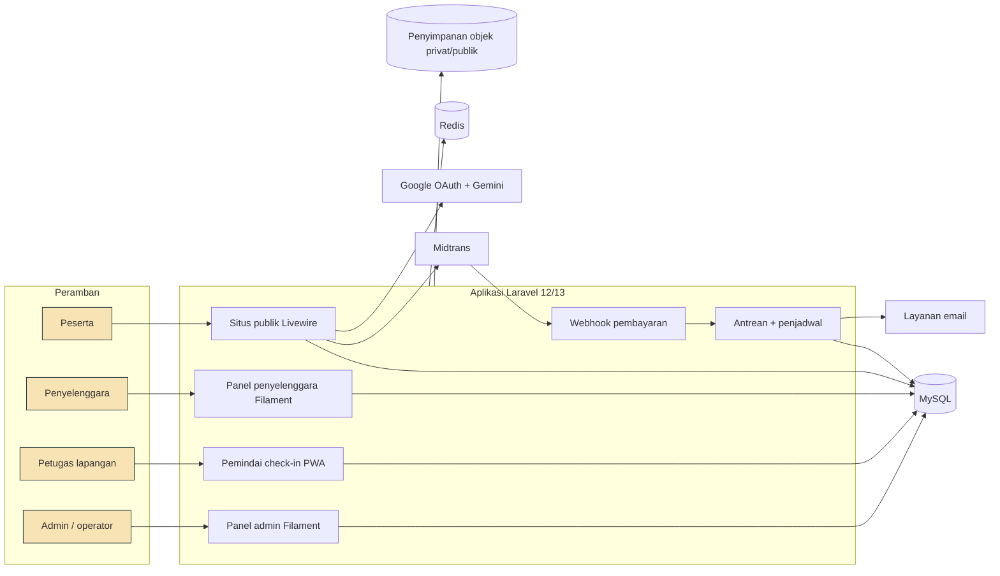
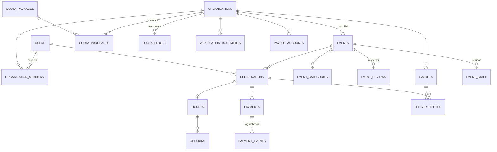
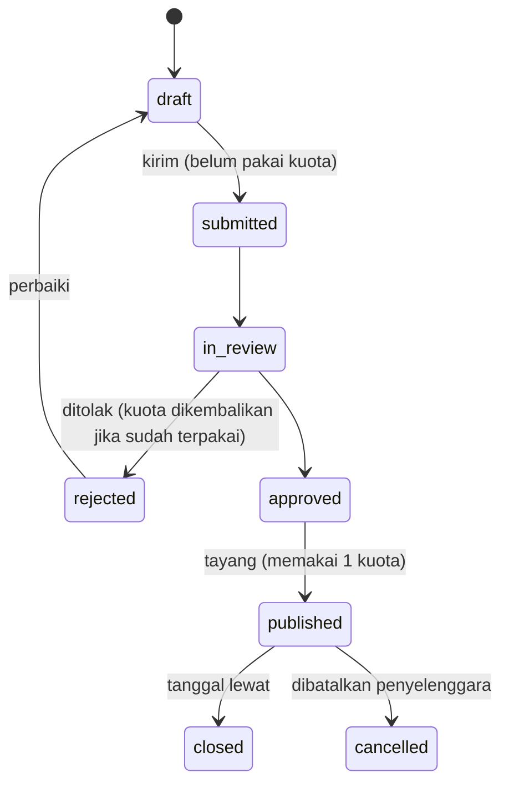
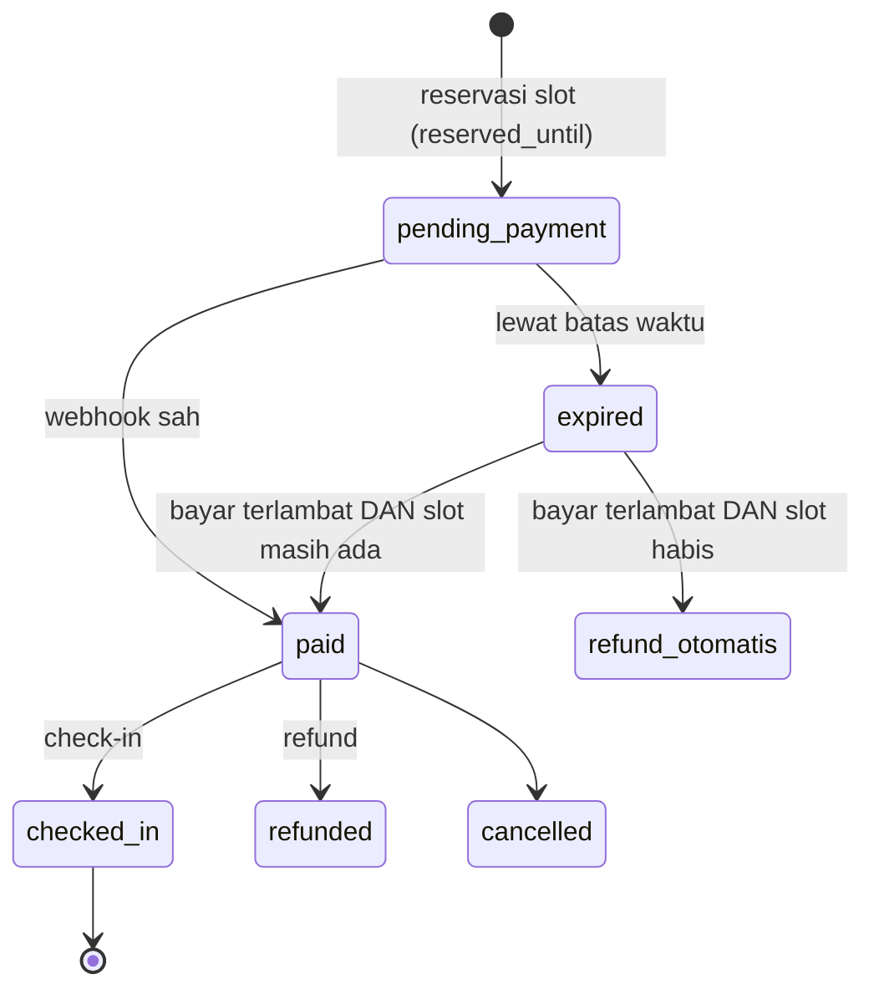
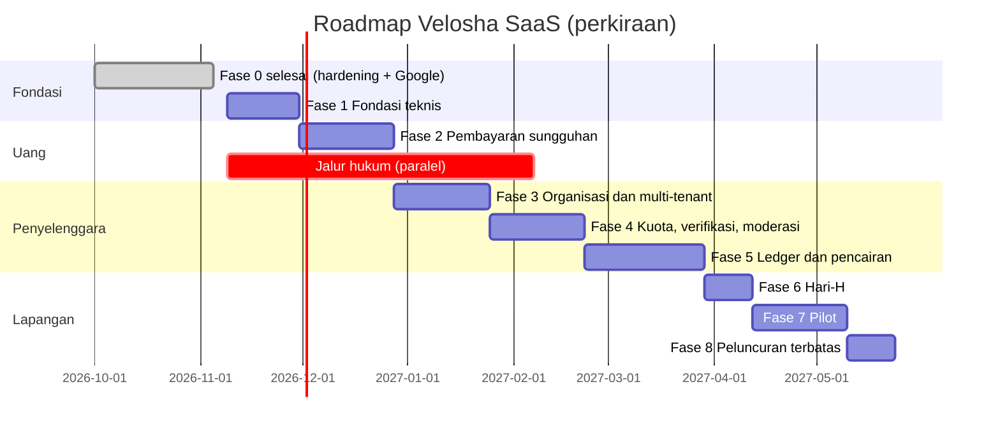

# Plan-SaaS.md — Velosha menjadi Platform Event Bersepeda untuk Penyelenggara

| | |
|---|---|
| **Versi** | 1.2 (draf kerja) — Midtrans terkonfirmasi; istilah “tanda tangan” diluruskan; QR tanpa tanda tangan; prompt agen dipindah ke `Prompt-SaaS.md` |
| **Tanggal** | 3 November 2026 |
| **Status basis kode** | Fase 0 selesai: audit, hardening keamanan, login Google (menunggu digabung ke `main`) |
| **Cara membaca** | Setiap klaim diberi label: **[T]** terverifikasi dari kode/audit · **[A]** asumsi saya, perlu Anda konfirmasi · **[K]** keputusan yang masih harus Anda ambil |

---

## 1. Ringkasan eksekutif

**Apa yang dibangun.** Velosha sudah menjadi platform tiket dan pendaftaran event bersepeda untuk peserta. Rencana ini menambahkan sisi **penyelenggara**: komunitas atau EO membayar paket **kuota event** (tanpa masa aktif), memverifikasi diri, membuat event sendiri, menjual tiket lewat Velosha, dan menerima hasil penjualan.

**Model bisnis (disepakati dalam diskusi).**
1. **Kuota event** per paket (misalnya 1, 3, 10 event), dibeli sekali, tidak kedaluwarsa. Fungsinya menyaring event spam dan menutup biaya moderasi.
2. **Biaya layanan per tiket terjual** sebagai sumber pendapatan utama [A].
3. Fitur tambahan berbayar belakangan (domain sendiri, anggota tim, laporan lanjutan, tahunan tanpa batas untuk EO besar) [A].

**Yang sudah kuat [T]:** peran penyelenggara dan kepemilikan event ada, BIB aman dari tabrakan, data sensitif terenkripsi, 346 tes lulus di cabang hardening, dan Mizu tidak mengirim data pribadi ke Gemini.

**Tiga celah terbesar sebelum menjual ke pihak luar [T]:**
1. **Pembayaran masih simulasi.** Tidak ada gateway, webhook, reservasi kuota, atau refund.
2. **Belum ada konsep organisasi.** Event terikat ke satu pengguna (`events.user_id`), bukan komunitas yang punya anggota tim.
3. **Hari-H belum sungguhan.** Check-in hanya mengubah `registrations.status`; tabel `tickets` tidak pernah ditulis, tidak ada pemindai QR, dan peran `operator` tidak bisa mengakses panel.

**Urutan pengerjaan.** Fondasi teknis → pembayaran sungguhan → organisasi dan multi-tenant → paket kuota + verifikasi + moderasi → uang penyelenggara (ledger dan pencairan) → hari-H → pilot dengan penyelenggara nyata → peluncuran terbatas. Perkiraan total **sekitar 5–7 bulan** untuk satu pengembang dibantu agen AI [A], dengan jalur hukum berjalan paralel.

**Aturan emas.** Jangan menerima uang penyelenggara sebelum Fase 2 (pembayaran), Fase 5 (ledger) dan konsultasi hukum selesai.

---

## 2. Tujuan, ruang lingkup, dan batasan

### 2.1 Tujuan
1. Penyelenggara dapat mendaftar, membayar kuota, diverifikasi, dan menayangkan event tanpa campur tangan teknis tim Velosha.
2. Peserta tetap mendapat pengalaman beli tiket yang sama baiknya, atau lebih baik.
3. Uang peserta dan data pribadi aman, dapat diaudit, dan dapat direkonsiliasi.
4. Tim kecil bisa menjalankan platform ini (moderasi dan dukungan tidak menjadi hambatan).

### 2.2 Di dalam lingkup
Organisasi dan anggota tim, paket kuota, verifikasi penyelenggara, moderasi event, pembayaran sungguhan, ledger dan pencairan, check-in hari-H dengan pemindai QR, peran petugas lapangan, laporan dasar penyelenggara, email transaksional, dan dukungan helpdesk per penyelenggara.

### 2.3 Di luar lingkup (sengaja ditunda)
Perangkat keras RFID dan timing langsung, aplikasi seluler asli, pelacakan langsung peserta, virtual race, dan marketplace pihak ketiga. Hasil timing hanya diimpor dari vendor di tahap lanjut.

### 2.4 Prinsip desain
- **Uang dalam bilangan bulat rupiah.** Tidak pernah memakai angka desimal mengambang.
- **Catatan keuangan tidak boleh diubah** (append-only).
- **Setiap tabel yang menyimpan data penyelenggara membawa `organization_id`** dan diuji pemisahan datanya.
- **Perubahan skema bertahap** (expand, backfill, switch, contract) agar tidak ada waktu henti.
- **Setiap fitur uang punya uji konkurensi dan uji pemutaran ulang webhook.**

---

## 3. Keputusan dan asumsi

| # | Topik | Asumsi saya | Status | Dampak bila berubah |
|---|---|---|---|---|
| D1 | Payment gateway | **Midtrans Snap**, sandbox dulu | **[T]** dikonfirmasi pemilik | Kode dibuat di balik antarmuka `PaymentGateway` agar bisa diganti; kunci ditambahkan belakangan di `.env` |
| D2 | Aliran dana | **Model A:** Velosha menerima dana lalu mencairkan ke penyelenggara (bukan penyelenggara punya akun merchant sendiri) | **[K]** | Model A menuntut kepatuhan hukum dan ledger penuh; Model B (akun merchant penyelenggara) jauh lebih sederhana tapi UX lebih berat |
| D3 | Dana ditahan | Sebagian dana ditahan sampai event selesai dan tidak ada sengketa; persentase ditentukan bersama penyelenggara | **[K]** | Menentukan aturan pencairan di ledger |
| D4 | Peran hari-H | **Petugas lapangan terpisah** (akses hanya pemindai dan check-in) | **[K]** | Tanpa ini, petugas memakai akun admin atau penyelenggara yang berlebihan |
| D5 | Kuota paket | 1, 3, dan 10 event; tanpa masa aktif; harga per event turun di paket besar; **harga ditentukan setelah wawancara** | **[K]** | Mengubah data seed, bukan arsitektur |
| D6 | Multi-tenant | Satu basis data, kolom `organization_id`, bukan basis data per penyelenggara | **[A]** | Basis data per tenant jauh lebih mahal dioperasikan untuk tim kecil |
| D7 | Panel | Dua panel Filament: **admin** (staf Velosha) dan **penyelenggara** (dengan tenancy organisasi) | **[A]** | Periksa dukungan tenancy di dokumentasi Filament 5 sebelum mulai |
| D8 | Kebijakan refund | Refund hanya jika event dibatalkan penyelenggara atau sesuai kebijakan per event; dipotong dari dana ditahan | **[K]** | Mempengaruhi ledger dan syarat penyelenggara |
| D9 | Hosting | Satu VPS terkelola atau PaaS, basis data dan Redis terpisah, penyimpanan objek S3-kompatibel | **[A]** | Pilih penyedia setelah anggaran jelas |
| D10 | Lisensi kode | **Proprietary**; repositori privat | **[A]** | Mengganti `composer.json` dan menambah berkas LICENSE |
| D11 | Tim dan kecepatan | Satu pengembang dengan bantuan agen AI, sekitar 20–30 jam per minggu | **[A]** | Semua estimasi waktu di bagian 12 bergantung pada ini |
| D12 | Verifikasi webhook Midtrans (signature) | **Wajib** | **[T]** | Tanpa ini siapa pun bisa memalsukan "pembayaran berhasil" (lihat 6.6) |
| D13 | QR bertanda tangan HMAC | **Tidak dipakai** (QR = token acak yang dicocokkan ke basis data) | **[T]** keputusan pemilik | Baru dipertimbangkan jika check-in luring benar-benar dibutuhkan |

---

## 4. Kondisi saat ini (fakta terverifikasi)

### 4.1 Teknologi **[T]**
| Komponen | Versi / keterangan |
|---|---|
| PHP | `^8.2` (runtime lokal 8.2.12) |
| Laravel | 12 (`^12.0`) |
| Livewire | 4 (`^4.4`) |
| Filament | 5 |
| QR | `chillerlan/php-qrcode` |
| Basis data | MySQL/MariaDB; antrean, cache, sesi memakai driver `database` |
| Email | `MAIL_MAILER=log` (email **tidak terkirim**) |
| Berkas | disk lokal (`public`) |
| AI | Google Gemini lewat HTTP, nama model di konfigurasi |

> Catatan: dokumen `rangkum.md` Anda menyebut Laravel 11 dan Livewire 3. **Itu usang**; perbarui sebelum dipakai sebagai acuan agen.

### 4.2 Yang sudah ada dan bagus **[T]**
- Peran `peserta`, `penyelenggara`, `operator`, `admin` pada `users.role`.
- Filament membatasi event ke pemiliknya (`events.user_id`) untuk penyelenggara.
- BIB dengan `bib_counters` dan penguncian, kuota dicek dalam transaksi terkunci saat pembayaran selesai.
- NIK, telepon darurat, dan catatan medis terenkripsi (cast).
- Tes: 346 lulus di `chore/phase0-hardening` (setelah digabung dengan Google sekitar 358), termasuk uji IDOR berpasangan, uji konkurensi kuota, penjagaan produksi untuk demo login dan simulasi pembayaran.
- Hardening Fase 0: pembersih HTML, token QR acak, pembatasan laju, pengaman basis data tes, rute bisa di-cache.
- Login Google (Socialite) dengan syarat email terverifikasi dan pemblokiran tautan otomatis ke peran staf.

### 4.3 Celah yang menghalangi SaaS **[T]**

| # | Celah | Bukti | Dampak SaaS |
|---|---|---|---|
| G1 | Pembayaran simulasi saja | `Checkout::simulatePaid`, `config/payments.php` | Tidak ada uang nyata, webhook, refund |
| G2 | Tidak ada reservasi kuota | kuota dicek saat pembayaran selesai | Dengan uang nyata pengguna bisa **sudah bayar lalu ditolak** karena kuota habis |
| G3 | Tidak ada kedaluwarsa pendaftaran | audit | Pendaftaran `pending` menumpuk dan menahan slot |
| G4 | `UNIQUE [user_id, event_id]` pada `registrations` | migrasi | Menghalangi daftar ulang setelah kedaluwarsa dan pendaftaran untuk teman/keluarga |
| G5 | Event terikat ke satu pengguna | `events.user_id` (cascade) | Tidak ada tim, kuota, verifikasi, atau uang per organisasi; menghapus pengguna menghapus event |
| G6 | Satu pengguna satu peran | `users.role` | Penyelenggara tidak bisa membeli tiket dengan akun yang sama |
| G7 | Check-in tidak sungguhan | `RegistrationsTable` hanya ubah `registrations.status` | Tak ada log siapa/kapan, tak ada pemindai, tak bisa dibatalkan |
| G8 | Operator tidak punya panel | `canAccessPanel` | Petugas lapangan tidak punya alat kerja |
| G9 | Helpdesk global | `helpdesk_tickets` tanpa event/organisasi | Penyelenggara tidak bisa melihat aduan tentang eventnya |
| G10 | Email tidak terkirim | `MAIL_MAILER=log` | Reset sandi dan e-ticket tidak sampai |
| G11 | Dokumen verifikasi belum punya tempat aman | disk `public` | KTP dan akta harus di disk privat |
| G12 | Tidak ada CI, pemantauan galat, atau cadangan terdokumentasi | repositori | Risiko operasional |
| G13 | Mizu memakai aturan global | `MizuAiService` | Jawaban salah untuk event yang aturannya berbeda |
| G14 | Beberapa halaman publik lambat | `rider_final.png` 3,5 MB | Memperburuk muat halaman |
| G15 | PHP 8.2 dan Laravel 12 mendekati akhir dukungan | dokumentasi rilis | Jadwalkan upgrade (lihat bagian 9.6) |

---

## 5. Arsitektur target

### 5.1 Gambaran umum

### 5.2 Multi-tenancy: satu basis data, `organization_id`
**Pola.**
- Tabel inti: `organizations`, `organization_members`.
- `events.organization_id` menjadi pemilik data. Tabel turunan (`event_categories`, `registrations`, `tickets`, `payments`, `ledger_entries`, `checkins`) membawa `organization_id` **didenormalisasi** supaya dapat difilter langsung dan dilindungi indeks komposit.
- Trait `BelongsToOrganization` dengan *global scope* pada konteks penyelenggara (panel Filament dengan tenancy). Di luar panel (situs publik, peserta) scope tidak aktif, tetapi akses dibatasi policy dan kueri eksplisit.
- Setiap sumber daya penyelenggara punya Policy; setiap Policy punya **uji berpasangan** (pemilik 200, organisasi lain 403/404), sama polanya dengan `IdorSecurityTest` yang sudah ada.

**Mengapa bukan basis data per penyelenggara?** Biaya operasional, migrasi skema, dan pelaporan lintas tenant jauh lebih besar untuk tim kecil, tanpa manfaat berarti pada skala awal.

**Verifikasi sebelum membangun [A]:** pastikan Filament 5 mendukung tenancy untuk panel, seperti pada versi sebelumnya (periksa dokumentasi `HasTenants`). Jika tidak cukup, bungkus dengan middleware sendiri.

### 5.3 Peran dan hak akses

Pisahkan **peran platform** dari **peran organisasi**.

| Tingkat | Peran | Cakupan |
|---|---|---|
| Platform | `peserta` (bawaan semua pengguna), `operator` (helpdesk), `admin` (staf Velosha) | Seluruh platform |
| Organisasi | `owner`, `manager`, `staf` (lihat peserta, laporan) | Per organisasi |
| Event | `petugas_lapangan` (hanya pemindai dan check-in untuk event tertentu) | Per event, berlaku terbatas waktu |

**Perubahan kunci:** setiap pengguna terautentikasi boleh mendaftar sebagai peserta. Kolom `users.role` hanya untuk peran platform; keanggotaan organisasi disimpan di `organization_members`. Dengan begitu satu orang bisa menjadi peserta sekaligus penyelenggara, atau anggota beberapa komunitas.

**Matriks hak akses (ringkas)**

| Aksi | peserta | staf org | manager | owner | petugas | operator | admin |
|---|:-:|:-:|:-:|:-:|:-:|:-:|:-:|
| Beli tiket, lihat tiket sendiri | ✓ | ✓ | ✓ | ✓ | ✓ | ✓ | ✓ |
| Lihat peserta event organisasi | | ✓ | ✓ | ✓ | (hanya daftar start) | | ✓ |
| Buat/ubah event, kategori, harga | | | ✓ | ✓ | | | ✓ |
| Kirim event untuk moderasi | | | ✓ | ✓ | | | ✓ |
| Beli kuota, kelola anggota | | | | ✓ | | | ✓ |
| Lihat saldo, ajukan pencairan | | | | ✓ | | | ✓ |
| Check-in lewat pemindai | | | ✓ | ✓ | ✓ | | ✓ |
| Moderasi event, verifikasi dokumen | | | | | | | ✓ |
| Tangani tiket bantuan | | | | | | ✓ | ✓ |

### 5.4 Model data (tambahan dan perubahan)

**Tabel baru (kolom kunci)**

| Tabel | Kolom kunci | Catatan |
|---|---|---|
| `organizations` | id, name, slug (unik), status (`pending`, `verified`, `suspended`), verified_at, contact_email, settings JSON | Pemilik data penyelenggara |
| `organization_members` | organization_id, user_id, role (`owner`,`manager`,`staf`), invited_at, accepted_at | Unik `[organization_id, user_id]` |
| `quota_packages` | id, name, events_count, price_idr, is_active | Seed 1/3/10 |
| `quota_purchases` | id, organization_id, package_id, amount_idr, status, payment_id | Pembelian lewat gateway |
| `quota_ledger` | id, organization_id, delta (+/−), reason (`purchase`,`consume`,`refund`,`adjust`), event_id, created_by, created_at | **Append-only**; saldo = jumlah delta |
| `verification_documents` | id, organization_id, type (`ktp_pengurus`,`akta`,`sk`,…), path (disk **privat**), status (`pending`,`approved`,`rejected`), reviewed_by, note | Berkas tidak pernah di disk `public` |
| `payout_accounts` | id, organization_id, bank, account_number (terenkripsi), account_name, verified_at | Nama harus sama dengan organisasi atau pengurus |
| `event_reviews` | id, event_id, status, reviewer_id, note, created_at | Riwayat moderasi |
| `event_staff` | event_id, user_id, role, valid_from, valid_until, invite_code_hash | Petugas lapangan terbatas waktu |
| `payments` | id, organization_id, registration_id / quota_purchase_id, provider, order_id (unik), amount_idr, status, expires_at, paid_at, raw_status | Satu sumber kebenaran status pembayaran |
| `payment_events` | id, payment_id, provider, provider_event_key (unik), payload JSON, signature_valid, processed_at, error | Log mentah webhook; **unik** untuk anti-duplikat |
| `ledger_entries` | id, organization_id, event_id, registration_id, payout_id, type, amount_idr, direction, available_at, created_at | **Append-only**; lihat 6.3 |
| `payouts` | id, organization_id, amount_idr, status, requested_by, approved_by, paid_at, bank_reference | Alur persetujuan ganda |
| `checkins` | id, ticket_id, event_id, organization_id, scanned_by, scanned_at, method (`qr`,`manual`), result, device | Log tak berubah |

**Perubahan pada tabel yang ada**

| Tabel | Perubahan |
|---|---|
| `users` | tambah `google_id`/`provider` (sudah ada dari fitur Google); `role` hanya peran platform |
| `events` | tambah `organization_id`; `user_id` menjadi `created_by` dengan `nullOnDelete`; tambah `status` moderasi (`draft`, `submitted`, `in_review`, `approved`, `rejected`, `published`, `closed`, `cancelled`), soft delete |
| `event_categories` | tambah `reserved_count`; tambah `organization_id` (denormalisasi) |
| `registrations` | tambah `organization_id`, `reserved_until`, status baru `expired`/`refunded`; **ganti** unik `[user_id,event_id]` dengan aturan yang mengizinkan daftar ulang setelah `expired`/`cancelled` (mis. indeks unik parsial atau unik pada `[user_id, event_id, active_flag]`), dan putuskan soal pendaftaran untuk orang lain (K) |
| `tickets` | tambah `organization_id`; kolom `is_checked_in`, `checked_in_at`, `checked_in_by_admin` digantikan oleh tabel `checkins` (tetap diisi sementara untuk kompatibilitas) |
| `helpdesk_tickets` | tambah `event_id` dan `organization_id` (nullable) untuk perutean |
| semua kunci asing keuangan | **tidak boleh `cascade`**; pakai `restrict` atau soft delete |

### 5.5 State machine

**Event**

**Aturan kuota** (disepakati dalam diskusi):

| Situasi | Kuota |
|---|---|
| Draf | tidak terpakai |
| Ditolak moderasi | dikembalikan |
| Tayang | terpakai 1 |
| Batal sebelum ada tiket terjual | dikembalikan |
| Batal setelah ada tiket terjual | hangus; refund peserta tetap kewajiban penyelenggara |
| Mengubah event yang sudah tayang | tidak memakai kuota baru |
| Banyak kategori atau banyak hari | tetap 1 kuota (tetapkan batas jumlah hari) |

**Pendaftaran dan pembayaran**

---

## 6. Alur uang

### 6.1 Prinsip
- Semua nominal **bilangan bulat rupiah**.
- Status pembayaran hanya berubah lewat **webhook terverifikasi** (atau polling status sebagai cadangan), tidak pernah dari klien.
- Setiap perubahan uang menghasilkan baris `ledger_entries` yang **tidak boleh diubah**; koreksi dilakukan dengan baris baru.
- Kunci idempotensi pada `payments.order_id` dan `payment_events.provider_event_key`.

### 6.2 Alur pembelian tiket
1. Peserta memilih kategori → sistem **mereservasi slot** dalam transaksi terkunci: `reserved_count += 1`, buat `registrations(status=pending_payment, reserved_until=now+TTL)` dan `payments(order_id unik)`.
2. Aplikasi membuat transaksi di Midtrans (Snap token) dan menampilkan jendela bayar.
3. Midtrans memanggil **webhook** (Notification URL). Sistem, berurutan:
   1. Simpan payload mentah di `payment_events` (kunci unik anti-duplikat).
   2. **Verifikasi signature Midtrans:** `SHA512(order_id + status_code + gross_amount + server_key)`, dengan `gross_amount` persis seperti string yang diterima (contoh `"100000.00"`). Bandingkan dengan `hash_equals`. Jika tidak cocok: tolak dan jangan proses.
   3. Pastikan `order_id` dikenal dan nominalnya sama dengan `payments.amount_idr`.
   4. **Anggap berhasil hanya jika** `status_code = 200`, `transaction_status` adalah `settlement` atau `capture`, dan `fraud_status` adalah `accept` bila ada (kartu).
   5. Proses lewat job antrean secara idempoten. Notifikasi bisa datang **tidak berurutan** (misalnya `settlement` sebelum `pending`), jadi status hanya boleh maju: `pending → paid` dan `pending → expire/cancel/deny`; notifikasi lama tidak boleh menurunkan status.
   6. Bila notifikasi diragukan atau tidak tiba, tanyakan ke Midtrans lewat **Get Status API** (cadangan dan penantang).
4. Jika berhasil: `payments.status=paid`, `registrations.status=paid`, `reserved_count -= 1; registered_count += 1`, BIB dan tiket QR diterbitkan, baris ledger dibuat (penjualan, biaya gateway, biaya layanan), email e-ticket dikirim.
5. Penjadwal setiap menit melepas reservasi yang `reserved_until`-nya lewat (`expired`) dan mengembalikan slot.
6. Pembayaran terlambat: jika slot masih ada, pulihkan; jika habis, refund otomatis dan beri tahu peserta.
7. Rekonsiliasi harian: bandingkan total `paid` dengan laporan penyelesaian gateway; selisih memicu peringatan.

**TTL yang disarankan [A]:** 60 menit untuk QRIS dan kartu; hingga 24 jam untuk Virtual Account (slot tetap tertahan selama itu; sesuaikan kuota yang boleh ditahan).

### 6.3 Ledger (pembukuan sederhana)
Setiap penjualan menghasilkan baris-baris berikut (contoh konsep, bukan angka):

| Jenis | Arah | Penjelasan |
|---|---|---|
| `sale` | kredit penyelenggara | Harga tiket |
| `gateway_fee` | debit penyelenggara (atau diteruskan ke peserta) | Biaya penyedia pembayaran **[K: siapa menanggung]** |
| `platform_fee` | debit penyelenggara | Biaya layanan Velosha per tiket |
| `hold` / `release` | memindahkan antara "ditahan" dan "tersedia" | Dana ditahan sampai event selesai dan tanpa sengketa **[K: persentase]** |
| `refund` | debit | Refund peserta; dipotong dari dana ditahan dahulu |
| `payout` | debit | Pencairan ke rekening terverifikasi |

Saldo penyelenggara = jumlah baris. Laporan "tersedia", "ditahan", "sudah dicairkan" dihitung dari ledger, bukan disimpan sebagai angka terpisah.

### 6.4 Pencairan
1. Syarat: verifikasi 4 dari 4 selesai, rekening terverifikasi, saldo `tersedia > 0`.
2. Pemilik organisasi mengajukan → admin menyetujui (persetujuan ganda untuk nominal besar) → transfer (manual dulu, otomatis lewat produk pencairan penyedia di tahap lanjut) → baris `payout` dan bukti referensi bank tercatat.
3. Laporan penyelesaian per event dan ekspor untuk pembukuan penyelenggara.

### 6.5 Peringatan hukum dan pajak **(wajib dibahas dengan ahli sebelum Fase 5)**
- Menerima dana peserta lalu mencairkannya ke pihak lain dapat masuk wilayah **regulasi sistem pembayaran**. Alternatif yang lebih aman: memakai fitur penyelesaian/pemisahan dana atau pencairan dari gateway berlisensi, atau Model B (penyelenggara memakai akun merchant sendiri).
- **Perlakuan pajak** atas biaya layanan dan penjualan kuota: tanyakan ke akuntan/konsultan pajak. Mockup sengaja tidak mencantumkan PPN.
- **Pendaftaran sebagai penyelenggara sistem elektronik (PSE)** diperlukan untuk platform digital di Indonesia.
- **Pelindungan Data Pribadi:** Velosha menyimpan NIK, golongan darah (kemungkinan tergolong data kesehatan), dan kontak darurat. Lihat bagian 9.

### 6.6 Tentang istilah “tanda tangan” (signature)
Rencana ini **tidak memakai tanda tangan elektronik pengguna**: tidak ada tanda tangan orang di dokumen mana pun. Kata “tanda tangan” di versi sebelumnya adalah terjemahan *signature*, yaitu **kode pengaman hasil hitungan** yang dipakai mesin untuk memastikan sebuah pesan benar-benar asli. Ada dua penggunaan:

| Penggunaan | Status | Alasan |
|---|---|---|
| Verifikasi signature webhook Midtrans | **Wajib** | Satu-satunya cara memastikan pesan “pembayaran berhasil” benar dari Midtrans. Dokumentasi Midtrans menegaskan signature harus selalu diperiksa. Tanpa itu, siapa pun bisa mengirim permintaan palsu dan mendapat tiket gratis. Pemeriksaan ini **mencegah** penyalahgunaan |
| QR bertanda tangan HMAC | **Tidak dipakai** | QR hanya berisi token acak yang dicocokkan ke basis data (sudah aman). Tanda tangan baru berguna untuk check-in tanpa internet, dan menambah risiko: bila kunci penandatangan bocor, orang bisa membuat QR palsu yang tampak sah |

**Kunci rahasia yang tetap harus dijaga** (kebocorannya yang bisa disalahgunakan): `MIDTRANS_SERVER_KEY`, `APP_KEY`, `GOOGLE_CLIENT_SECRET`, `GEMINI_API_KEY`. Aturannya: hanya di `.env` atau pengelola rahasia, tidak pernah di repositori, tidak dicetak ke log, berbeda untuk sandbox dan produksi, diputar ulang bila dicurigai bocor, dan dipantau pemindaian rahasia di CI.

---

## 7. Modul fungsional

### 7.1 Penyelenggara: daftar, kuota, verifikasi, moderasi
Alur (sudah dirancang di mockup kanvas: "Pilih paket", "Bayar paket", "Verifikasi", "Dasbor", "Buat event", "Pembayaran & pencairan"):

1. Pengguna login (email/Google) → **Jadi penyelenggara** → membuat organisasi (menjadi `owner`).
2. Pilih paket kuota → bayar (alur pembayaran sama dengan tiket, jenis produk berbeda) → `quota_ledger` +N.
3. **Verifikasi 4 langkah:** email/telepon, KTP pengurus, dokumen komunitas, rekening pencairan. Dokumen di **disk privat**; admin meninjau lewat panel admin; setiap keputusan dicatat.
4. **Buat event** (draf tidak memakai kuota) → kirim → **moderasi** admin (event pertama selalu ditinjau; penyelenggara tepercaya boleh lebih longgar) → tayang (kuota dipakai 1).
5. Dasbor: penjualan, peserta, kuota, status verifikasi, saldo.

**Moderasi.** Antrean di panel admin dengan SLA internal (misalnya 1×24 jam kerja [A]), alasan penolakan terstruktur, dan tombol **lapor event** untuk publik.

### 7.2 Peserta
- Tiket tetap di `/ticket/{registration}` dengan pemeriksaan pemilik (sudah terbukti diuji).
- Boleh mendaftar untuk orang lain? **[K]** Disarankan: satu pendaftaran per orang (nama dan NIK berbeda), dibuat oleh pembeli yang sama; ini mengubah indeks unik (lihat 5.4).
- Ganti nama/transfer tiket dan daftar tunggu: tahap lanjut.

### 7.3 Hari-H
- **Pemindai QR** (halaman web responsif / PWA) untuk `petugas_lapangan`: memindai token, memverifikasi ke server, menandai check-in, mencatat `checkins`, mencegah check-in ganda, dan menampilkan data minimum (nama, BIB, kategori, kontak darurat hanya jika diperlukan).
- **Cadangan manual:** cari nama/BIB bila QR rusak; tercatat sebagai `method=manual`.
- **QR tidak ditandatangani (keputusan D13):** isi QR adalah token acak yang dicocokkan ke basis data saat dipindai. Check-in luring dengan tanda tangan HMAC hanya dipertimbangkan bila benar-benar dibutuhkan, dan hanya setelah ada prosedur simpan dan rotasi kunci (lihat 6.6).
- **Akses petugas:** diberikan lewat undangan terbatas waktu per event; berakhir otomatis setelah event.
- Perbaiki G7: tulis `tickets` dan `checkins`, hapus ketergantungan pada `registrations.status` saja.

### 7.4 Komunikasi
- **Email transaksional** lewat layanan email (reset sandi, e-ticket, status verifikasi, hasil moderasi, struk pembayaran). Kirim lewat antrean.
- **WhatsApp:** tahap lanjut dan opsional.
- **Siaran ke peserta oleh penyelenggara:** dibatasi (templat, batas frekuensi) agar tidak menjadi saluran spam.

### 7.5 Helpdesk dan Mizu per penyelenggara
- Helpdesk mendapat `event_id`/`organization_id`; penyelenggara melihat aduan eventnya, admin tetap melihat semuanya.
- **Mizu** menerima konteks **per event** (aturan, jadwal, kontak) dari data event, bukan dari teks global. Jawaban dibatasi pada konteks yang diberikan, dengan penyerahan ke manusia dan catatan bahwa jawaban AI bukan keputusan resmi. Data satu penyelenggara tidak boleh ikut dalam jawaban untuk yang lain.

### 7.6 Laporan penyelenggara
Penjualan harian, pendaftar per kategori, ukuran jersey, ekspor CSV daftar peserta (dengan pembatasan kolom sensitif), laporan penyelesaian untuk pembukuan.

### 7.7 Peta ke mockup di kanvas
| Fitur | Artboard |
|---|---|
| Ajakan jadi penyelenggara | "Ajakan penyelenggara" (desktop dan HP) |
| Pilih paket kuota | "Penyelenggara — pilih paket kuota" |
| Bayar paket | "Penyelenggara — bayar paket" |
| Verifikasi | "Penyelenggara — verifikasi" |
| Dasbor | "Penyelenggara — dasbor" |
| Buat event | "Penyelenggara — buat event" |
| Pembayaran dan pencairan | "Penyelenggara — pembayaran & pencairan" |
| Pembayaran tiket berhasil | "Pembayaran berhasil" |
| Footer baru | "Footer" |

**Belum ada mockup:** dasbor HP, daftar peserta, admin moderasi/verifikasi, pemindai check-in, pengaturan organisasi dan anggota.

---

## 8. Infrastruktur dan operasional

| Area | Rencana |
|---|---|
| **Lingkungan** | `local`, `staging` (Midtrans sandbox, data sintetis), `production` |
| **Antrean/cache/sesi** | Pindah dari driver `database` ke **Redis** sebelum membuka penjualan besar |
| **Penjadwal** | Cron memanggil `schedule:run` tiap menit (pelepasan reservasi, rekonsiliasi, pengingat) |
| **Penyimpanan berkas** | Disk **privat** (dokumen verifikasi, berkas rekening) dan disk **publik** (banner, foto, GPX); gunakan penyimpanan objek S3-kompatibel |
| **Email** | Layanan email transaksional dengan SPF/DKIM/DMARC |
| **Cadangan** | Basis data harian + berkas; **uji pemulihan setiap bulan**; simpan cadangan `APP_KEY` terpisah (kolom terenkripsi tidak dapat dipulihkan tanpanya) |
| **Pemantauan** | Pelacak galat (mis. Sentry), uptime monitor, peringatan kegagalan webhook dan antrean, log terstruktur |
| **CI/CD** | GitHub Actions: `pint`, analisis statis (mis. Larastan), tes PHPUnit dengan SQLite/MySQL service, pemindaian rahasia; deploy tanpa henti dengan rilis bertahap |
| **Rahasia** | Disimpan di pengelola rahasia penyedia hosting, tidak pernah di repositori; rotasi terjadwal |
| **Performa** | Cache katalog, indeks sesuai pola kueri (`[organization_id, event_id, status]`), kompres gambar hero (3,5 MB → WebP), uji beban untuk hari pembukaan tiket (misalnya k6) |
| **Skalabilitas hari pembukaan** | Pembatasan laju, antrean, reservasi dengan TTL; ruang tunggu sebagai tahap lanjut |

---

## 9. Keamanan, privasi, dan kepatuhan

### 9.1 Kontrol teknis
1. **Isolasi tenant:** seluruh sumber daya penyelenggara diuji berpasangan (pemilik vs organisasi lain), termasuk Livewire (`#[Locked]`, otorisasi ulang di setiap aksi) dan Filament.
2. **Autentikasi:** email terverifikasi wajib untuk penyelenggara; **MFA** untuk `owner`, `admin`, dan `operator` (periksa dukungan bawaan Filament 5).
3. **Pembatasan laju** di semua rute autentikasi dan pembayaran (sudah ada untuk daftar dan lupa sandi).
4. **Sanitasi konten buatan penyelenggara** (sudah ada `HtmlSanitizer`; izinkan gambar hanya dari penyimpanan sendiri).
5. **Unggahan berkas:** validasi tipe dan ukuran, nama acak, pemindaian ekstensi ganda, disk privat untuk dokumen.
6. **Webhook:** verifikasi signature, pencocokan nominal, idempotensi, log mentah.
7. **Log audit** untuk tindakan sensitif: verifikasi, moderasi, perubahan harga, pencairan, ekspor peserta, perubahan peran. Log tidak bisa diubah pengguna biasa.
8. **Header keamanan** dan HTTPS wajib di produksi (sudah ada `forceScheme`); tinjau Content-Security-Policy.
9. **Cadangan `APP_KEY`:** simpan aman; rencanakan prosedur rotasi kunci terenkripsi.

### 9.2 Data pribadi
- Data yang dikumpulkan (NIK, golongan darah, kontak darurat, tanggal lahir, nomor telepon) dikelompokkan sebagai **sensitif**. Terapkan **minimisasi:** penyelenggara hanya melihat kolom yang perlu untuk event mereka; NIK disembunyikan sebagian di tampilan kecuali untuk peran tertentu; ekspor dicatat di log audit.
- **Retensi:** tentukan lamanya penyimpanan setelah event (misalnya data medis dihapus atau dianonimkan N bulan setelah event) **[K]**.
- **Perjanjian pemrosesan data** dalam Syarat Penyelenggara: Velosha dan penyelenggara menjelaskan peran masing-masing atas data peserta.
- **Hak subjek data:** akses, koreksi, penghapusan; siapkan prosedur dan formulir permintaan.
- **Mizu dan Gemini:** jangan mengirim NIK, nama lengkap, atau data kesehatan ke penyedia AI; catat kebijakan ini di halaman privasi.

### 9.3 Daftar kepatuhan (konsultasikan dengan ahli)
- [ ] Pendaftaran PSE lingkup privat.
- [ ] Kepatuhan Undang-Undang Pelindungan Data Pribadi (kebijakan privasi, dasar pemrosesan, retensi, prosedur insiden).
- [ ] Kepatuhan regulasi sistem pembayaran untuk aliran dana (Model A vs B).
- [ ] Pajak atas pendapatan platform dan faktur.
- [ ] Syarat Penyelenggara, Kebijakan Refund, Kebijakan Privasi, dan Ketentuan Peserta yang spesifik.

### 9.4 Respons insiden
Dokumen satu halaman: siapa dihubungi, cara mencabut kunci, cara memberi tahu pengguna terdampak, dan tenggat pemberitahuan menurut ketentuan yang berlaku.

### 9.5 Rahasia dan repositori
Repositori **privat**, pemindaian rahasia (gitleaks) pada CI, kunci diganti jika pernah bocor, lisensi **proprietary**.

### 9.6 Versi dan dukungan
Jadwalkan **upgrade ke PHP 8.3/8.4 dan Laravel 13** pada Fase 1. Laravel 12 menerima tambalan keamanan sampai sekitar awal 2027 dan dukungan keamanan PHP 8.2 diperkirakan berakhir akhir 2026 (periksa laravel.com/docs/releases dan php.net/supported-versions).

---

## 10. Strategi pengujian

| Lapisan | Isi | Contoh |
|---|---|---|
| Unit | Aturan kuota, perhitungan ledger, kalkulasi biaya | Pembulatan, nominal nol, negatif |
| Fitur | Alur lengkap per peran | Daftar → bayar → tiket; penyelenggara → kuota → event tayang |
| **Isolasi tenant** | Untuk **setiap** sumber daya: pemilik 200, organisasi lain 403/404, tamu redirect | Event, peserta, pembayaran, ledger, check-in, helpdesk |
| **Konkurensi** | Dua pembeli berebut slot terakhir; dua webhook bersamaan; dua pemindai pada tiket yang sama | Tidak ada oversell, tidak ada check-in ganda |
| **Webhook** | Pemutaran ulang, urutan terbalik, signature salah, nominal tak cocok | Status akhir tetap benar |
| **Waktu** | Reservasi kedaluwarsa, pembayaran terlambat (slot ada / habis) | Dengan jam beku |
| Keamanan | XSS, IDOR, pembatasan laju, unggahan berbahaya | Menambah `IdorSecurityTest` |
| End-to-end | Playwright untuk alur utama (skrip tangkap layar yang sudah ada bisa menjadi dasar) | Peserta dan penyelenggara |
| Beban | k6 pada pembukaan tiket | Target dan ambang ditetapkan setelah Fase 2 |
| Rekonsiliasi | Uji data sintetis ledger vs laporan gateway | Selisih nol |

**Gerbang CI:** tidak ada penggabungan ke `main` jika tes gagal, `pint` gagal, atau pemindaian rahasia menemukan sesuatu.

---

## 11. Model bisnis dan validasi

### 11.1 Struktur harga **[K]**
| Komponen | Keterangan |
|---|---|
| Paket kuota | 1 / 3 / 10 event, tanpa masa aktif; harga **ditentukan setelah wawancara** (angka di mockup hanya contoh) |
| Biaya layanan per tiket | Persentase atau nominal tetap; tentukan siapa menanggung biaya gateway |
| Tambahan berbayar | Domain sendiri, anggota tim tambahan, laporan lanjutan, paket tahunan tanpa batas untuk EO besar |

### 11.2 Lembar unit ekonomi (isi dengan angka asli, bukan tebakan)
Variabel: rata-rata tiket per event, harga tiket rata-rata, biaya layanan per tiket, biaya gateway, biaya dukungan dan moderasi per event, biaya infrastruktur bulanan, pembelian kuota ulang per tahun. Keluaran: margin per event dan titik impas.

### 11.3 Metrik utama
Event tayang per bulan, tiket terjual per event, GMV, take rate, rasio penyelesaian pembayaran, waktu dari daftar sampai event pertama tayang, persentase penyelenggara yang membeli kuota lagi, dan jumlah tiket bantuan per event.

### 11.4 Validasi sebelum Fase 5
1. Wawancara **5–10 penyelenggara** (komunitas, klub, EO): proses sekarang, biaya, keberatan, kesediaan membayar kuota.
2. **Pilot:** satu sampai tiga penyelenggara menjalankan event nyata dengan bantuan manual penuh dari Anda.
3. **Kriteria pilot [A]:** sekurangnya 3 event selesai, tidak ada kejadian uang salah, ≥70% pendaftaran yang dimulai berakhir bayar, dan penyelenggara bersedia membeli kuota kedua.

---

## 12. Roadmap

> Langkah rinci, prompt agen, dan gerbang tiap fase ada di **`Prompt-SaaS.md`** (Peta Navigasi). Bagian ini menjelaskan alasan dan perkiraan waktu.

Perkiraan dengan asumsi D11 (satu pengembang plus agen, 20–30 jam/minggu). Setiap fase berakhir dengan **kriteria selesai** yang bisa diuji.

### Fase 0 — selesai
Audit, hardening, login Google. **Sisa:** gabungkan ke `main` dengan urutan yang benar, jadikan repositori privat, jalankan gitleaks, pindahkan berkas audit keluar repositori.

### Fase 1 — Fondasi teknis (±3 minggu)
| ID | Tugas | Kriteria selesai |
|---|---|---|
| F1-01 | Upgrade PHP 8.3/8.4 dan Laravel 13 | Semua tes lulus; `composer audit` bersih |
| F1-02 | CI GitHub Actions (tes, pint, analisis statis, pemindaian rahasia) | PR gagal bila salah satu gagal |
| F1-03 | Redis untuk antrean/cache/sesi; Horizon atau pekerja terawasi | Pekerja berjalan terus dan bangkit otomatis |
| F1-04 | Email sungguhan (SMTP/penyedia) + templat dasar | Reset sandi dan e-ticket tiba di kotak masuk uji |
| F1-05 | Pemantauan galat dan uptime | Galat uji muncul di dasbor |
| F1-06 | Cadangan terjadwal + uji pemulihan pertama | Prosedur pemulihan terdokumentasi dan teruji |
| F1-07 | Lingkungan staging | Deploy otomatis dari `main` ke staging |
| F1-08 | README, lisensi proprietary, perbaikan metadata `composer.json` | Orang baru bisa menjalankan proyek dari README |
| F1-09 | Kompres gambar hero (WebP) dan bersihkan aset mockup | Gambar hero < 250 KB |
| F1-10 | Ganti `users.role`-only dengan rancangan peran baru (hanya desain + tes, belum migrasi) | Dokumen peran disetujui |

### Fase 2 — Pembayaran sungguhan (±4 minggu)
| ID | Tugas | Kriteria selesai |
|---|---|---|
| F2-01 | Antarmuka `PaymentGateway`, `FakeGateway` (tes/lokal), `MidtransGateway` (klien HTTP Laravel, tanpa SDK) | Tes memakai kunci tiruan; tanpa panggilan jaringan |
| F2-02 | Tabel `payments`, `payment_events` | Migrasi dan indeks unik anti-duplikat |
| F2-03 | Reservasi slot dengan TTL (`reserved_until`, `reserved_count`) | Uji konkurensi: tidak ada oversell |
| F2-04 | Webhook: verifikasi signature, nominal, idempotensi, status hanya maju, job antrean | Uji putar ulang, urutan terbalik, dan signature salah lulus |
| F2-05 | Penjadwal pelepasan reservasi kedaluwarsa | Slot kembali otomatis |
| F2-06 | Pembayaran terlambat: pulihkan atau refund otomatis | Uji untuk kedua cabang |
| F2-07 | Ubah indeks unik `registrations` untuk daftar ulang setelah kedaluwarsa | Uji daftar ulang lulus |
| F2-08 | Refund dasar (event dibatalkan) lewat API | Refund tercatat dan status benar |
| F2-09 | Rekonsiliasi harian dan peringatan selisih | Laporan harian ada |
| F2-10 | Nonaktifkan jalur simulasi di staging/produksi (tetap lokal) | Tes penjagaan produksi tetap lulus |
| F2-11 | Halaman pembayaran berhasil sesuai mockup | Sesuai artboard |
| F2-12 | Notification URL di dasbor sandbox + terowongan untuk lokal; rute webhook tanpa CSRF dan tanpa autentikasi, dengan pembatasan laju | Notifikasi sandbox sampai ke aplikasi lokal |
| F2-13 | **Daftar Penerimaan Sandbox** (setelah kunci ada): buat transaksi, bayar lewat simulator, terima webhook, ulang webhook, kedaluwarsa, batal, refund | Semua skenario lulus di akun sandbox |

#### Strategi “kode dulu, kunci belakangan”
Kode boleh ditulis sebelum akun Midtrans ada, dengan syarat:
1. Semua pemanggilan Midtrans lewat antarmuka `PaymentGateway`; `FakeGateway` dipakai untuk tes dan lokal.
2. Tes memakai kunci tiruan dan menghitung signature sendiri; tidak ada panggilan jaringan.
3. Variabel di `.env.example` (nama saja, tanpa nilai): `PAYMENT_GATEWAY` (`fake` atau `midtrans`), `MIDTRANS_ENV` (`sandbox` atau `production`), `MIDTRANS_SERVER_KEY`, `MIDTRANS_CLIENT_KEY`, `MIDTRANS_MERCHANT_ID` (opsional).
4. Di produksi aplikasi **menolak berjalan** bila `PAYMENT_GATEWAY=fake`, atau bila `midtrans` dipilih tetapi kunci kosong.
5. Klien HTTP bawaan Laravel dipakai tanpa SDK pihak ketiga, supaya jalur uang tidak menambah dependensi.

**Batas yang perlu Anda sadari:** kode yang belum pernah berbicara dengan Midtrans nyata hanya terbukti benar terhadap dokumentasi, bukan terhadap perilaku sebenarnya. Begitu akun sandbox siap (gratis), jalankan F2-13 sebelum Fase 2 dinyatakan selesai.

> **Titik berhenti:** setelah Fase 2, Velosha sudah bisa menjual tiket event milik Anda sendiri dengan uang nyata. Itu pencapaian bernilai bahkan tanpa SaaS.

### Fase 3 — Organisasi dan multi-tenant (±4 minggu)
| ID | Tugas | Kriteria selesai |
|---|---|---|
| F3-01 | Tabel `organizations`, `organization_members` | Migrasi aman |
| F3-02 | Migrasi data bertahap: setiap penyelenggara lama → organisasi (expand → backfill → switch → contract) | Semua event punya `organization_id`; tak ada data hilang |
| F3-03 | Ubah `events.user_id` menjadi `created_by` (`nullOnDelete`), soft delete | Menghapus pengguna tidak menghapus event |
| F3-04 | Denormalisasi `organization_id` pada tabel turunan + indeks komposit | Kueri laporan memakai indeks |
| F3-05 | Trait dan *global scope*, Policy tiap sumber daya | Uji isolasi tenant lulus untuk semua sumber daya |
| F3-06 | Panel penyelenggara Filament dengan tenancy, panel admin terpisah | Penyelenggara A tak bisa melihat B |
| F3-07 | Lepas pembatas `role:peserta` untuk pendaftaran; semua pengguna terautentikasi boleh mendaftar | Penyelenggara dapat membeli tiket |
| F3-08 | Undangan anggota dan peran organisasi | Alur undang-terima teruji |
| F3-09 | Perutean helpdesk per event/organisasi | Penyelenggara melihat aduan eventnya |

### Fase 4 — Kuota, verifikasi, moderasi (±4 minggu)
| ID | Tugas | Kriteria selesai |
|---|---|---|
| F4-01 | `quota_packages`, `quota_purchases`, `quota_ledger` | Saldo kuota benar dari ledger |
| F4-02 | Halaman paket dan bayar paket (sesuai mockup) | Pembelian sandbox menambah kuota |
| F4-03 | Penggunaan kuota saat event tayang, pengembalian saat ditolak/batal | Semua aturan 5.5 diuji |
| F4-04 | Disk privat + unggahan dokumen verifikasi | Dokumen tak bisa diakses lewat URL publik |
| F4-05 | Antrean verifikasi dan moderasi di panel admin | Admin dapat setuju/tolak dengan alasan |
| F4-06 | Status event baru dan riwayat `event_reviews` | Alur draf→tayang bekerja |
| F4-07 | Tombol lapor event dan penanganannya | Laporan masuk ke antrean admin |
| F4-08 | Email status verifikasi dan moderasi | Email terkirim |
| F4-09 | Log audit untuk tindakan sensitif | Tindakan tercatat dan tak dapat diubah |

### Fase 5 — Ledger dan pencairan (±5 minggu, **butuh keputusan hukum D2/D3**)
| ID | Tugas | Kriteria selesai |
|---|---|---|
| F5-01 | `ledger_entries` append-only + layanan pencatat | Setiap penjualan/refund menghasilkan baris benar |
| F5-02 | Aturan hold/release dan perhitungan saldo | Saldo tersedia/ditahan cocok dengan uji sintetis |
| F5-03 | `payout_accounts` terenkripsi + verifikasi nama | Rekening tak bisa dilihat penuh oleh peran lain |
| F5-04 | Pengajuan, persetujuan ganda, pencatatan pencairan | Alur lengkap teruji |
| F5-05 | Laporan penyelesaian per event + ekspor | Cocok dengan ledger |
| F5-06 | Halaman "Pembayaran & pencairan" sesuai mockup | Sesuai artboard |
| F5-07 | Pencairan otomatis lewat produk penyedia (opsional) | Setelah aturan hukum jelas |

### Fase 6 — Hari-H (±2 minggu)
| ID | Tugas | Kriteria selesai |
|---|---|---|
| F6-01 | Tabel `checkins`, penulisan `tickets` | Check-in tercatat dengan petugas dan waktu |
| F6-02 | Pemindai QR web (kamera), pencegahan check-in ganda | Uji dua pemindai pada satu tiket |
| F6-03 | `event_staff` dan undangan petugas terbatas waktu | Akses habis otomatis |
| F6-04 | Cadangan manual (cari nama/BIB) | Tercatat sebagai manual |
| F6-05 | Daftar start dan ekspor untuk petugas | Hanya kolom minimum |
| F6-06 | Uji lapangan dengan simulasi 100+ peserta | Waktu per check-in memenuhi target |

### Fase 7 — Pilot (±4 minggu)
Satu sampai tiga penyelenggara nyata, pendampingan manual, perbaikan berdasarkan masukan, dan penetapan harga final. Kriteria di 11.4.

### Fase 8 — Peluncuran terbatas dan pertumbuhan
Buka pendaftaran penyelenggara terbatas (undangan atau daftar tunggu), pantau metrik, lalu tambahkan secara bertahap: domain sendiri, impor hasil timing vendor, sertifikat digital, WhatsApp, dasbor HP, API, ruang tunggu untuk pembukaan tiket besar.

---

## 13. Risiko dan mitigasi

| # | Risiko | Kemungkinan | Dampak | Mitigasi |
|---|---|---|---|---|
| R1 | Kebocoran data antar penyelenggara | Sedang | Tinggi | Uji isolasi untuk semua sumber daya, global scope, tinjauan kode, log audit |
| R2 | Oversell atau bayar lalu ditolak | Sedang | Tinggi | Reservasi TTL, uji konkurensi, pembayaran terlambat ditangani |
| R3 | Webhook palsu atau duplikat | Sedang | Tinggi | Verifikasi signature, nominal, idempotensi, log mentah |
| R4 | Masalah regulasi aliran dana | Sedang | Sangat tinggi | Konsultasi hukum sebelum Fase 5; pertimbangkan Model B |
| R5 | Kebocoran kunci atau `APP_KEY` hilang | Rendah | Tinggi | Repositori privat, gitleaks, cadangan kunci, rotasi |
| R6 | Penyelenggara palsu atau event penipuan | Sedang | Tinggi | Verifikasi, moderasi event pertama, penahanan dana, tombol lapor |
| R7 | Beban lonjakan saat tiket dibuka | Sedang | Sedang | Redis, antrean, cache, uji beban, pembatasan laju |
| R8 | Jawaban Mizu salah soal refund/aturan | Sedang | Sedang | Konteks per event, batasan, penyerahan ke manusia |
| R9 | Satu pengembang menjadi titik tunggal | Tinggi | Sedang | Dokumentasi, CI, runbook, tes yang kuat |
| R10 | Perubahan skema merusak data | Sedang | Tinggi | Expand→backfill→switch→contract, cadangan sebelum migrasi, uji di staging |
| R11 | Pendapatan tidak cukup menutup dukungan | Sedang | Sedang | Lembar unit ekonomi, otomatisasi moderasi, harga berdasarkan wawancara |
| R12 | Versi PHP/Laravel kehilangan dukungan | Pasti (waktu) | Sedang | F1-01 dan jadwal upgrade tahunan |
| R13 | Agen AI mengubah hal di luar tugas | Sedang | Sedang | Aturan kerja di bagian 14 |
| R14 | Data pribadi bocor lewat ekspor penyelenggara | Sedang | Tinggi | Minimisasi kolom, log ekspor, kebijakan |

---

## 14. Aturan kerja dengan agen AI (pelajaran dari Fase 0)

1. **Satu tugas, satu sesi baru.** Konteks yang menumpuk membuat agen mencampur pekerjaan lama.
2. **Rencana dulu.** Agen membalas rencana, Anda membalas "go". Periksa daftar berkas yang akan disentuh.
3. **Larangan perintah Git** yang mengubah pohon kerja (checkout, switch, restore, reset, clean, stash, rebase, merge) kecuali Anda yang memerintahkan.
4. **Tidak pernah `git add .` atau `git commit -a`.** Stage berkas dengan nama, tampilkan `git diff --cached --name-only` sebelum komit.
5. **Satu komit per butir tugas** dengan pesan yang jelas.
6. **Bukti eksekusi, bukan ringkasan.** Minta keluaran nyata perintah dan jumlah tes. Waspadai hasil yang "lulus" tanpa kontrol positif.
7. **Tidak mengarang rute, kolom, atau nomor baris.** Jika tidak dibuka, tulis `NOT VERIFIED`.
8. **Tidak membaca atau mencetak rahasia.** `.env` tidak dikirim; hanya nama variabel.
9. **Basis data uji terpisah** (`velosha_test`), pengaman di `TestCase` mencegah salah target.
10. **Tidak ada berkas bantu di repositori;** skrip sementara di luar proyek dan dihapus.
11. **Tinjauan baca-saja sebelum menggabungkan fitur sensitif** (login, pembayaran, ledger).
12. **Anda yang memeriksa hasil di peramban** untuk setiap perubahan tampilan atau alur uang.
13. **Kunci rahasia:** agen tidak pernah membaca `.env`, tidak mencetak nilai kunci, tidak menaruh kunci di kode, tes, atau log; hanya nama variabel di `.env.example`.

---

## 15. Keputusan terbuka dan langkah berikutnya

### 15.1 Keputusan yang Anda perlu ambil (dalam urutan kepentingan)
1. ~~K1 — Gateway~~ **Selesai: Midtrans.** (D1)
2. **K2 — Aliran dana:** Model A (Velosha memegang dana) atau Model B (akun merchant penyelenggara)? Konsultasikan dulu ke penasihat hukum. (D2)
3. **K3 — Dana ditahan:** persentase dan aturan pelepasan. (D3)
4. **K4 — Petugas lapangan:** setuju peran terpisah? (D4)
5. **K5 — Harga kuota dan biaya layanan:** tentukan setelah wawancara 5–10 penyelenggara. (D5, 11.1)
6. **K6 — Siapa menanggung biaya gateway:** peserta atau penyelenggara?
7. **K7 — Pendaftaran untuk orang lain:** boleh atau satu akun satu pendaftaran?
8. **K8 — Retensi data:** berapa lama data peserta, terutama data medis, disimpan setelah event?
9. **K9 — Kebijakan refund bawaan.** (D8)
10. **K10 — Hosting dan anggaran.** (D9)
11. **K11 — Target peluncuran** dan jumlah jam kerja per minggu yang realistis. (D11)

### 15.2 Langkah 30 hari ke depan
1. Selesaikan Fase 0: gabungkan ke `main`, repositori privat, gitleaks.
2. Mulai **Fase 1** (upgrade, CI, email, pemantauan, cadangan).
3. Jadwalkan **wawancara penyelenggara** dan mulai **konsultasi hukum dan pajak** secara paralel.
4. Pilih gateway dan buat akun sandbox, lalu mulai **Fase 2**.

### 15.3 Gerbang sebelum membuka ke penyelenggara luar
- [ ] Fase 2 selesai dan teruji dengan uang sandbox dan satu transaksi nyata kecil.
- [ ] Fase 3 selesai dan uji isolasi tenant untuk semua sumber daya lulus.
- [ ] Verifikasi dokumen aman di disk privat.
- [ ] Log audit aktif untuk tindakan sensitif.
- [ ] Cadangan teruji dipulihkan.
- [ ] Kebijakan privasi, Syarat Penyelenggara, dan Kebijakan Refund terbit.
- [ ] Konsultasi hukum dan pajak untuk aliran dana selesai.
- [ ] Pilot minimal satu penyelenggara tanpa insiden uang.

---

## Lampiran A — Daftar istilah
| Istilah | Arti |
|---|---|
| Tenant / organisasi | Komunitas atau EO penyelenggara; pemilik data event |
| Kuota event | Jumlah event yang boleh ditayangkan, dibeli per paket |
| Reservasi | Menahan slot sementara sebelum pembayaran selesai |
| Idempoten | Pemrosesan ulang input yang sama menghasilkan hasil yang sama |
| Ledger | Catatan keuangan append-only yang menjadi sumber saldo |
| Hold / release | Menahan dan melepas dana penyelenggara |
| BIB | Nomor dada peserta |
| PSE | Penyelenggara sistem elektronik |
| MFA | Autentikasi multi-faktor |
| Signature | Kode pengaman hasil hitungan (hash) yang membuktikan sebuah pesan berasal dari pengirim yang sah. **Bukan** tanda tangan orang |

## Lampiran B — Sumber fakta
Dokumen ini disusun dari: `composer.json` (diperiksa langsung), `AUDIT.md` dan `AUDIT_IDOR.md` yang telah dikoreksi, hasil uji IDOR, laporan Fase 0 (346 tes), tinjauan login Google, dan seluruh mockup di kanvas Velosha. Angka waktu dan harga adalah **perkiraan** sampai Anda mengonfirmasi D11 dan K5.

---

## Lampiran C — Peta langkah dan prompt agen

Seluruh prompt agen dan peta langkah berurutan dipindahkan ke berkas pasangan **`Prompt-SaaS.md`** supaya tidak ada dua versi yang berbeda. Isinya:

| Bagian | Isi |
|---|---|
| 0 | Cara memakai: persiapan tiap langkah, cara memeriksa hasil agen, apa yang dilakukan bila tersesat |
| 1 | **Peta Navigasi** Fase 0 sampai 8: setiap langkah punya ID, pelaku ([ANDA] atau [AGEN]), prompt, dan bukti selesai, plus **Gerbang** di akhir tiap fase |
| 2 | Blok acuan: A0 (aturan umum agen) dan A1 (spesifikasi Midtrans yang diverifikasi) |
| 3 | Prompt per fase: P1-01 sampai P7-01 (30 prompt) |
| 4 | Prompt gerbang dan bantu: G1 (audit fase), G2 (cek posisi), G3 (tinjauan kode fitur sensitif) |

Hubungan dengan rencana ini: bagian 12 (Roadmap) menjelaskan **mengapa** dan **berapa lama**; `Prompt-SaaS.md` menjelaskan **apa yang dikerjakan hari ini** dan **dengan kalimat apa meminta agen mengerjakannya**.
